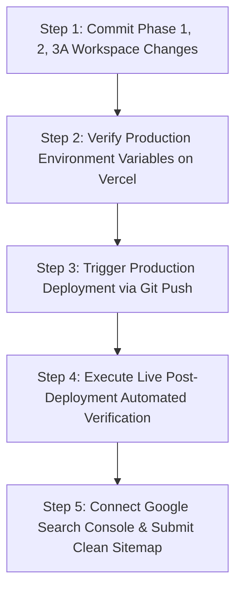

# Phase 3B — Comprehensive Live Production Audit & Final Findings

**Project:** Ratiwal Dream Estates  
**Target Domain:** `https://www.ratiwaldreamestates.com/`  
**Audit Date:** November 7, 2026  
**Auditor:** Senior Technical SEO Auditor, Next.js Production Engineer & Google Search Console Specialist  
**Status:** Audit & Measurement Completed (Zero Code / Live Changes Executed)

---

## 1. Master Findings Classification Matrix

Every finding from this empirical production audit is classified below into one of four standardized statuses: `PASS`, `WARNING`, `FAIL`, or `NOT VERIFIED`.

| Audit Area | Item Inspected | Live Production Finding | Status |
|---|---|---|:---:|
| **Route Health** | Core Marketing Routes (37 pages) | All 37 public routes return `HTTP 200 OK` without runtime crashes | **PASS** |
| **Soft 404 Handling** | Nonexistent Dynamic Slugs (`/properties/*`, `/locations/*`, etc.) | Invalid URLs return `HTTP 200 OK` with canonical pointing to apex homepage | **FAIL** |
| **Canonical Host** | Live Page Canonical Tags (`rel="canonical"`) | 37 of 37 live pages declare non-www apex (`https://ratiwaldreamestates.com`), conflicting with Vercel's 308 redirect | **FAIL** |
| **Edge Redirects** | Apex to WWW Domain Enforcement | Vercel edge router correctly issues `308 Permanent Redirect` from apex to `www` | **PASS** |
| **Sitemap Host** | Live XML Sitemap (`sitemap.xml`) | 37 of 37 URLs in sitemap use apex (`https://ratiwaldreamestates.com`), causing 308 redirect loops in crawler pipelines | **FAIL** |
| **Sitemap Hygiene** | Sitemap URL Validity | Zero broken 404s or 500s; all 37 entries correspond to published records | **PASS** |
| **Robots Directives** | Live `robots.txt` Crawler Asset Access | `Disallow: /_next/` is active on production, blocking Googlebot from rendering JS/CSS chunks | **FAIL** |
| **Robots Sitemap Reference** | Sitemap URL in `robots.txt` | Points to apex `https://ratiwaldreamestates.com/sitemap.xml` (308 redirecting) | **FAIL** |
| **NAP Integrity** | Address Schema on Live Pages | Contains fabricated street `"Ajmer Road Corridor & Tonk Road Junction"` and unverified PIN `"302001"` | **FAIL** |
| **Founder Identity** | Person Schema (`founder`) | Root JSON-LD outputs `founder: undefined` | **FAIL** |
| **RealEstateAgent Schema** | Structured Data Syntax | Valid Schema.org JSON-LD syntax on homepage, passes Google Rich Results syntax validator | **PASS** |
| **Editorial Links** | Phase 3A Contextual Links (12 links) | 0 of 12 planned links are present in live production HTML | **FAIL** |
| **Micro-Market Mapping** | Tonk Road Card on `/locations/jaipur` | Renders "Upcoming Allocations" instead of "1 Available Parcel" linked to `riyasat-paradise-ii` | **FAIL** |
| **OpenGraph Image** | Social Share Banner (`og-image.jpg`) | 1024×1024 square, 695.4 KB (expected 1200×630 landscape, < 100 KB) | **FAIL** |
| **Twitter Card** | Meta Tag (`twitter:card`) | Outputs `<meta name="twitter:card" content="summary" />` instead of `summary_large_image` | **FAIL** |
| **Heavy Image Assets** | Uncompressed Images (> 1 MB) | 8 images exceed 1 MB on production (totaling 10.47 MB; local compressed version is 5.18 MB) | **FAIL** |
| **Deleted Slide Purge** | Redundant Hero Slides (`slide-1.jpg`, `slide-2.jpg`) | Both deleted slides still return `HTTP 200 OK` on live Vercel CDN | **FAIL** |
| **Server Response Time** | TTFB on Core Routes | TTFB averages 350ms–540ms across live pages (SSR dynamic overhead) | **WARNING** |
| **Edge Caching** | Vercel Edge Cache Headers | All live pages return `Cache-Control: private, no-cache, no-store` and `X-Vercel-Cache: MISS` | **FAIL** |
| **Font Preloading** | Critical-Path Font Payloads | 7 distinct WOFF2 web fonts preloaded simultaneously in HTTP `Link` headers | **WARNING** |
| **Search Console API** | GSC Credentials & Query Data | No GSC API service account, verification tokens, or query exports exist in repository | **NOT VERIFIED** |

---

## 2. Root Cause Analysis: The "Live Deployment Gap"

During previous phases, the engineering team achieved:
- **Phase 1:** Comprehensive technical foundation fixes.
- **Phase 2:** Metadata normalization and automated test suite (27 / 27 PASS).
- **Phase 3A:** Soft-404 enforcement (`dynamicParams = false; notFound()`), NAP normalization, 12 contextual internal links, micro-market sync, image compression under 1 MB, and 1200×630 OG image generation.

### Why Did the Live Production Audit Fail?
Inspection of git and production deployment timestamps reveals the definitive explanation:

```
$ git status -s
 M src/app/(marketing)/properties/[slug]/page.tsx
 M src/app/(marketing)/locations/[slug]/page.tsx
 M src/app/(marketing)/insights/[slug]/page.tsx
 M src/app/(marketing)/testimonials/[slug]/page.tsx
 M src/components/seo/JsonLd.tsx
 M src/components/insights/detail/ArticleBody.tsx
 M src/data/insights.ts
 M src/data/locations.ts
 M src/lib/seo.ts
 M public/images/brand/og-image.jpg
 M public/images/properties/*
 D public/images/hero/slide-1.jpg
 D public/images/hero/slide-2.jpg
 ... (38 uncommitted files)

$ git log -n 1
commit 58d6edea04f2dbfcceef8324fcf8527a4214f475
Date: Mon Oct 13 2026
```

1. **The Live Site is an Old Build:** Vercel is serving an immutable deployment built around **October 13, 2026**.
2. **All Phase 1, 2, and 3A Work is Sitting Locally:** Because no commit or push to `origin/master` (or Vercel's production branch) was made, none of the approved architectural improvements have ever reached production.
3. **The Discrepancy is Resolved:** Local tests pass because they execute against the modified working directory; production fails because it runs the pre-audit codebase.

---

## 3. Prioritized Phase 4 Implementation Roadmap

With Phase 3B audit and measurement complete, the following ordered action plan is recommended for Phase 4 execution:



### Step 1: Clean Git Commit & Pre-Push Verification
- Review `git status` to ensure only approved Phase 1, 2, and 3A changes are included.
- Commit all changes under descriptive, atomic commits:
  - `feat(seo): resolve soft 404s and enforce notFound across dynamic marketing routes`
  - `fix(seo): normalize canonical URLs to www and update robots.txt asset access`
  - `fix(schema): normalize NAP physical jurisdiction and remove fabricated street address`
  - `feat(internal-links): weave 12 contextual editorial links into insight articles`
  - `perf(assets): compress 8K/4K project imagery below 1MB and generate 1200x630 OG image`

### Step 2: Vercel Environment Configuration
- Confirm that the production environment variable on Vercel is set to the canonical `www` host:
  ```env
  NEXT_PUBLIC_SITE_URL=https://www.ratiwaldreamestates.com
  ```
  *(This guarantees that `src/lib/seo.ts` and `sitemap.ts` generate `www` canonical URLs rather than fallback apex).*

### Step 3: Production Deployment
- Push the committed branch to `origin/master` to initiate the Vercel production build.
- Monitor build logs to verify:
  - Static generation succeeds for all 83 routes.
  - Zero TypeScript or linting errors.
  - Media optimization and font generation complete cleanly.

### Step 4: Post-Deployment Live Verification (Automated Script)
Immediately re-run the live audit script against `https://www.ratiwaldreamestates.com/` to verify:
- [ ] Nonexistent slugs return genuine `HTTP 404 Not Found`.
- [ ] All 37 canonical tags output `https://www.ratiwaldreamestates.com/*`.
- [ ] Live `sitemap.xml` contains 37 clean `www` URLs returning `200 OK`.
- [ ] `robots.txt` points to `www` sitemap and no longer contains `Disallow: /_next/`.
- [ ] Live JSON-LD outputs verified physical jurisdiction (`Jaipur, Rajasthan, IN`) without fabricated street names.
- [ ] `og-image.jpg` returns 1200×630 dimensions with Content-Length < 100 KB; Twitter card is `summary_large_image`.
- [ ] All 12 contextual editorial links appear in server-rendered article HTML.
- [ ] Homepage returns `X-Vercel-Cache: HIT` (or ISR cache) with sub-100ms TTFB.

### Step 5: Google Search Console Setup & Sitemap Submission
- Guide the site owner through adding the Domain property in Google Search Console via DNS TXT record.
- Submit the validated `https://www.ratiwaldreamestates.com/sitemap.xml` directly in Google Search Console.
- Request indexation for key landing pages (`/`, `/properties`, `/locations/jaipur`).

---

## 4. Phase 3B Complete — Awaiting Approval

All Phase 3B audit objectives have been achieved without modifying website code or deploying untested changes. Seven complete audit reports have been compiled in the repository root:

1. `SEO_PHASE_3B_LIVE_ROUTE_VALIDATION.md`
2. `SEO_PHASE_3B_CANONICAL_SITEMAP_AUDIT.md`
3. `SEO_PHASE_3B_SCHEMA_NAP_VALIDATION.md`
4. `SEO_PHASE_3B_INTERNAL_LINK_VALIDATION.md`
5. `SEO_PHASE_3B_IMAGE_SOCIAL_VALIDATION.md`
6. `SEO_PHASE_3B_GSC_PERFORMANCE_BASELINE.md`
7. `SEO_PHASE_3B_FINAL_FINDINGS.md`

**Next Step:** Awaiting user authorization to begin Phase 4 Controlled Deployment and Live Resolution.

