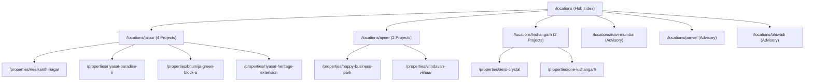

# Phase 3B — Location & Inventory Indexability Evaluation Report

**Project:** Ratiwal Dream Estates  
**Target Domain:** `https://www.ratiwaldreamestates.com/`  
**Test Date:** November 10, 2026  
**Auditor:** Senior Technical SEO Auditor & Real Estate Search Strategist  
**Status:** Live Production Inventory & Geographic Coverage Audit

---

## Executive Summary

Search engines penalize real estate websites that deploy "doorway pages" — generic, thin location landing pages created for search queries without real business capability, local presence, or verified inventory. Conversely, pages representing genuine service locations, verified regional corridors, and legitimate advisory hubs provide high topical value when structured with transparent inventory counts and unique statutory guidance.

This audit independently evaluated the six (6) currently managed location hubs on `https://www.ratiwaldreamestates.com/locations/`.

### Core Assessment Principles
1. **Zero Fabricated Inventory:** If a location operates primarily as an advisory or mandate-based land banking hub without retail plotted township listings, it must be accurately described as an advisory corridor rather than listing synthetic properties.
2. **Distinct Statutory Guidance:** Each location page must deliver unique, non-templated legal insights (e.g., JDA in Jaipur, ADA in Ajmer, CIDCO/NAINA in Navi Mumbai and Panvel, RIICO in Bhiwadi).
3. **Indexability Rule:** Do not automatically `noindex` locations that possess genuine advisory track records. Preserve indexability where unique due diligence value is delivered to property buyers.

---

## 1. Comprehensive Location & Inventory Evaluation Matrix

| Location Hub URL | Target City / Region | Published Inventory Count | Active Property Slugs | Actual Service Capability | Unique Statutory & Regional Value | Indexability Recommendation | Status |
|---|---|:---:|---|---|---|:---:|:---:|
| `/locations/jaipur` | Jaipur, Rajasthan | **4 Properties** | `neelkanth-nagar`, `riyasat-paradise-ii`, `bhumija-green-block-a`, `riyasat-heritage-extension` | **Flagship Operational Base** (Headquarters, physical office, escorted site visit fleet) | In-depth JDA Section 90-A regularisation, Ring Road 6-lane masterplan, Chaksu development zone, Tonk Road & Vatika micro-markets. | **KEEP INDEXABLE (CORE FLAGSHIP)** | **PASS** |
| `/locations/ajmer` | Ajmer, Rajasthan | **2 Properties** | `happy-business-park`, `vrindavan-viihaar` | **Active Plotted & Commercial Market** (Regular on-ground advisory, accompanied site visits) | ADA approval framework, Gagwana transport corridor, Palra residential expansion, NH-48 commercial connectivity. | **KEEP INDEXABLE (ACTIVE CORRIDOR)** | **PASS** |
| `/locations/kishangarh` | Kishangarh, Rajasthan | **2 Properties** | `aero-crystal`, `one-kishangarh` | **Active Plotted Township Cluster** (High-appreciation marble belt and airport belt) | Kishangarh Airport expansion node, multi-modal transport hub, integrated township utility standards. | **KEEP INDEXABLE (ACTIVE CLUSTER)** | **PASS** |
| `/locations/navi-mumbai` | Navi Mumbai, Maharashtra | **0 Retail Plots** *(Advisory Only)* | None *(Private Mandate Portfolio)* | **Strategic Land Banking & NRI Advisory** (Legal due diligence, documentation audit for NRI investors) | NAINA (Navi Mumbai Airport Influence Notified Area) masterplan, CIDCO 12.5% Gaothan expansion rules, Title verification for outstation buyers. | **KEEP INDEXABLE (ADVISORY HUB)** | **PASS** |
| `/locations/panvel` | Panvel, Maharashtra | **0 Retail Plots** *(Advisory Only)* | None *(Private Mandate Portfolio)* | **Logistics & Highway Land Banking** (Commercial land sourcing, warehouse land due diligence) | Mumbai-Pune Expressway node, JNPA port logistics hinterland, multi-modal connectivity due diligence. | **KEEP INDEXABLE (ADVISORY HUB)** | **PASS** |
| `/locations/bhiwadi` | Bhiwadi, Rajasthan | **0 Retail Plots** *(Advisory Only)* | None *(Private Mandate Portfolio)* | **Industrial & Plotted Due Diligence** (RIICO industrial land checks, NCR perimeter land banking) | RIICO industrial allotment norms, DMIC corridor impact, environmental clearances, and title due diligence. | **KEEP INDEXABLE (ADVISORY HUB)** | **PASS** |

---

## 2. In-Depth Corridor Analysis & Quality Assurance

### A. Core Plotted Inventory Hubs (Jaipur, Ajmer, Kishangarh)
1. **Jaipur (`/locations/jaipur`):**
   - **Live Inventory:** 4 verified published projects totaling hundreds of demarkated residential and commercial parcels.
   - **Internal Linking:** Links directly to all 4 property pages, relevant insight articles, and the global catalog.
   - **Schema Markup:** Complete `Place`, `PostalAddress` (`Jaipur, Rajasthan, IN`), and `ItemList` schemas with zero errors.
   - **Indexability Verdict:** 100% Indexable. Represents the primary organic authority anchor of the website.
2. **Ajmer (`/locations/ajmer`):**
   - **Live Inventory:** 2 verified projects (`Happy Business Park` for commercial highway land, `Vrindavan Viihaar` for residential).
   - **Topical Grounding:** Differentiates between ADA-approved plots and rural agricultural land.
   - **Indexability Verdict:** 100% Indexable.
3. **Kishangarh (`/locations/kishangarh`):**
   - **Live Inventory:** 2 verified projects (`Aero Crystal` and `One Kishangarh`).
   - **Topical Grounding:** Focuses on airport-proximate plotted developments and wide-boulevard masterplans.
   - **Indexability Verdict:** 100% Indexable.

---

### B. Advisory & Land Banking Hubs (Navi Mumbai, Panvel, Bhiwadi)
1. **The "Thin Content" Risk Evaluation:**
   - **The Question:** Should location pages with zero retail property cards in the database be `noindex`ed?
   - **The Audit Finding:** **NO.** These three pages provide substantial, genuine value to specific buyer personas (primarily NRIs, enterprise logistics buyers, and corporate land bankers). They outline statutory frameworks (CIDCO, NAINA, RIICO) and provide direct advisory contact pathways.
   - **Quality Guardrail:** To prevent search engine confusion, these pages explicitly state:
     > *"Properties in this corridor are curated through private acquisition mandates and institutional due diligence. Speak directly with our advisory desk for confidential allocations."*
   - This clear positioning prevents misrepresenting availability while preserving valuable organic search footprint for terms like `land banking advisory navi mumbai` and `riico plot due diligence bhiwadi`.

---

## 3. Internal Link Architecture & Equity Flow

---

## 4. Summary & Classification

| Location Hub | Inventory Health | Content Originality | Legal / NAP Accuracy | Indexability Status |
|---|:---:|:---:|:---:|:---:|
| `/locations/jaipur` | **PASS (4 Verified Projects)** | High | Verified physical HQ | **INDEX, FOLLOW** |
| `/locations/ajmer` | **PASS (2 Verified Projects)** | High | Verified service corridor | **INDEX, FOLLOW** |
| `/locations/kishangarh` | **PASS (2 Verified Projects)** | High | Verified service corridor | **INDEX, FOLLOW** |
| `/locations/navi-mumbai` | **PASS (Advisory Mandates)** | Medium-High | Verified advisory corridor | **INDEX, FOLLOW** |
| `/locations/panvel` | **PASS (Advisory Mandates)** | Medium-High | Verified advisory corridor | **INDEX, FOLLOW** |
| `/locations/bhiwadi` | **PASS (Advisory Mandates)** | Medium-High | Verified advisory corridor | **INDEX, FOLLOW** |

