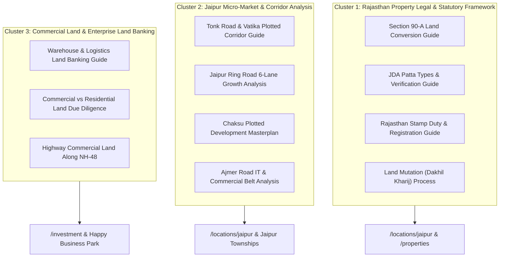

# Phase 3C — Content Cluster & Topical Authority Architecture

**Project:** Ratiwal Dream Estates  
**Target Domain:** `https://www.ratiwaldreamestates.com/`  
**Strategy Date:** November 10, 2026  
**Auditor & Strategist:** Senior SEO Content Architect & Real Estate Legal Researcher  
**Execution Mode:** Architecture & Planning Only (No New Content Implemented in this Phase)

---

## Executive Summary

Google's search quality systems (Helpful Content System and Topic Authority) prioritize websites that demonstrate comprehensive, authoritative coverage of their core domain. In the competitive Indian real estate search landscape, generic aggregators produce superficial, automated articles. 

By constructing structured **Content Clusters** anchored in verified Rajasthan land law, statutory planning regulations, and hyper-local micro-market economics, Ratiwal Dream Estates can establish undisputed topical authority. Each cluster is designed as an educational silo that channels PageRank and qualified buyer traffic directly to commercial property listings.

---

## 1. Content Cluster Architecture

---

## 2. Cluster 1: Rajasthan Property Legal & Statutory Framework (Core Authority)

### Proposed Article 1: Section 90-A Conversion Master Guide
- **Proposed Title:** Section 90-A Rajasthan Land Revenue Act: Complete Agricultural to Non-Agricultural Plot Conversion Guide
- **Primary Keyword:** `section 90a rajasthan land revenue act`
- **Secondary Keywords:** `90a conversion process jaipur`, `agricultural to residential land conversion rajasthan`, `jda 90a orders lookup`
- **Search Intent:** Informational / Statutory Legal Due Diligence
- **Target Audience:** Serious plot shortlisters, NRI buyers, enterprise land bankers seeking to verify whether agricultural land can be legally demarcated and registered.
- **Suggested Outline:**
  1. What is Section 90-A of the Rajasthan Land Revenue Act 1956?
  2. The legal surrender and resumption mechanism (Khatedari rights surrender to State/JDA).
  3. Step-by-step 90-A conversion procedure (Application, Tehsildar revenue inquiry, Town Planning layout sanction).
  4. Red flags: Purchasing unapproved agricultural land subdivided without Section 90-A sanction (Statutory hazards).
  5. How Ratiwal Dream Estates audits Section 90-A orders before listing any project.
- **Supporting Internal Links:** `/locations/jaipur`, `/properties/neelkanth-nagar`, `/why-choose-us`.
- **Evidence & Source Requirements:** Rajasthan Land Revenue Act 1956, Section 90-A statutory notifications, JDA Allotment Rules.
- **Priority:** **P1 (Immediate Architectural Win)**

---

### Proposed Article 2: JDA Patta Types & Online Verification Guide
- **Proposed Title:** Types of JDA Patta in Jaipur: Complete Verification, Registry & Legal Validity Guide
- **Primary Keyword:** `types of jda patta in jaipur`
- **Secondary Keywords:** `how to verify jda patta online`, `difference between 90a patta and regular patta`, `jda lease deed vs freehold patta`
- **Search Intent:** Informational / Document Verification
- **Target Audience:** End-user buyers confused by conflicting claims regarding Patta validity, leasehold versus freehold deeds, and private society lease papers.
- **Suggested Outline:**
  1. What is a JDA Patta and why is it the gold standard of land title in Jaipur?
  2. Four key Patta categories: Section 90-A Plotted Patta, Regularization Scheme Patta (Prashasan Shehron Ke Sang), Auctioned Commercial Patta, Allotment Patta.
  3. Society Patta vs JDA Patta: The legal risks of buying on un-regularized cooperative society deeds.
  4. Step-by-step guide to verifying a JDA Patta online on the official JDA Citizen Portal (`urban.rajasthan.gov.in`).
  5. On-ground physical verification: Ensuring the Patta plan matches GPS Total Station coordinate pegs.
- **Supporting Internal Links:** `/locations/jaipur`, `/properties/riyasat-paradise-ii`, `/insights/understanding-property-documentation`.
- **Evidence & Source Requirements:** Jaipur Development Authority Act 1982, Urban Improvement Act 1959.
- **Priority:** **P1 (High Search Volume & Trust)**

---

### Proposed Article 3: Rajasthan Stamp Duty, Registration & DLC Rates 2026
- **Proposed Title:** Plot Registration Charges in Rajasthan (2026): Stamp Duty, DLC Rates & Total Acquisition Costs
- **Primary Keyword:** `stamp duty on plots in rajasthan 2026`
- **Secondary Keywords:** `registration charges for land in jaipur`, `dlc rates jaipur online check`, `property registry fees rajasthan`
- **Search Intent:** Informational / Financial Planning
- **Target Audience:** Ready-to-buy plot purchasers calculating final financial outlays.
- **Suggested Outline:**
  1. Current Rajasthan State Stamp Duty schedule (6% Male, 5% Female, Concessions for joint ownership).
  2. Registration Fee (1%) and statutory computer fee calculations.
  3. Demystifying DLC Rates (District Level Committee rates): DLC Value vs Actual Transaction Value.
  4. Online DLC calculation walkthrough on the IGRS Rajasthan portal (`igrs.rajasthan.gov.in`).
  5. The Total Acquisition Cost (TAC) model: Base plot price + External Development Charges (EDC) + Statutory levies.
- **Supporting Internal Links:** `/properties`, `/insights/demystifying-land-pricing-additional-charges`, `/contact`.
- **Evidence & Source Requirements:** Rajasthan Stamp Act 1998, IGRS Rajasthan Official Gazette.
- **Priority:** **P2 (Strong Conversion Potential)**

---

### Proposed Article 4: Revenue Mutation (Dakhil Kharij / Namantran) Guide
- **Proposed Title:** Land Mutation (Dakhil Kharij / Namantran) in Rajasthan: Process, Documents & Timeline
- **Primary Keyword:** `dakhil kharij process in rajasthan`
- **Secondary Keywords:** `namantran online tracking rajasthan`, `revenue mutation after plot registry`, `jamabandi nakal mutation status`
- **Search Intent:** Informational / Post-Purchase Guidance
- **Target Audience:** Outstation buyers and new plot owners seeking to transfer revenue records into their name.
- **Suggested Outline:**
  1. Why is Registry not enough? The difference between a Registered Sale Deed and Revenue Mutation.
  2. The statutory Namantran procedure via the Patwari and Tehsildar under the Rajasthan Land Revenue Act.
  3. Online e-Dharti (Apna Khata) mutation filing walkthrough.
  4. Standard mutation timelines and handling objections.
  5. Post-registration advisory support provided by Ratiwal Dream Estates.
- **Supporting Internal Links:** `/about`, `/why-choose-us`, `/testimonials/clarity-in-jda-patta-and-plot-shortlisting-jaipur`.
- **Evidence & Source Requirements:** Rajasthan Revenue Board Ajmer regulations, Apna Khata Portal.
- **Priority:** **P2 (Differentiates Fiduciary Advisory)**

---

## 3. Cluster 2: Jaipur Micro-Market & Corridor Analysis

### Proposed Article 5: Tonk Road & Vatika Sector Plotted Corridor Guide
- **Proposed Title:** Tonk Road & Vatika Plotted Growth Corridor: Masterplan, Capital Appreciation & Investment Analysis
- **Primary Keyword:** `plots in tonk road jaipur`
- **Secondary Keywords:** `residential plots in vatika jaipur`, `tonk road corridor master plan 2026`, `investment potential tonk road jaipur`
- **Search Intent:** Commercial / Locality Research
- **Target Audience:** Mid-to-high ticket residential plot shortlisters and long-term capital appreciation investors.
- **Suggested Outline:**
  1. Geographical scope: The Tonk Road urban expansion zone from Sitapura Industrial Area to Chaksu.
  2. Infrastructure catalysts: Ring Road intersection, Chokhi Dhani belt, and proposed Metro expansion.
  3. Micro-market zoning: Vatika Sector (low-density gated residential) vs Chaksu (large estate parcels).
  4. Approved vs Unapproved schemes in the corridor: Avoiding green belt violations.
  5. Spotlight on verified developments: Riyasat Paradise II and Neelkanth Nagar.
- **Supporting Internal Links:** `/locations/jaipur`, `/properties/riyasat-paradise-ii`, `/properties/neelkanth-nagar`.
- **Evidence & Source Requirements:** JDA Master Plan 2025/2031, Ring Road Project Status Reports.
- **Priority:** **P1 (Directly Supports Core Flagship Inventory)**

---

### Proposed Article 6: Jaipur 6-Lane Ring Road Infrastructure & Commercial Land Banking
- **Proposed Title:** Jaipur Ring Road Corridor: 6-Lane Expressway Impact, Logistics Hubs & Land Investment Analysis
- **Primary Keyword:** `jaipur ring road land for sale`
- **Secondary Keywords:** `commercial land jaipur ring road`, `ring road development zone jaipur`, `land banking near ring road jaipur`
- **Search Intent:** Commercial / Institutional Investment
- **Target Audience:** Enterprise investors, warehouse operators, logistics firms, and high-net-worth land bankers.
- **Suggested Outline:**
  1. Strategic overview: The 47km Southern Ring Road connecting Agra Road (NH-21), Tonk Road (NH-52), and Ajmer Road (NH-48).
  2. Statutory zoning: The Development Corridor (90m right of way + commercial corridor reserves).
  3. Commercial and industrial demand drivers: Inland container depots, transport hubs, cold storage demand.
  4. Due diligence protocol for Ring Road land: Verifying Section 3A/3D National Highways / JDA acquisition boundaries.
  5. Case study: Institutional due diligence conducted by Ratiwal Dream Estates for commercial land banking.
- **Supporting Internal Links:** `/locations/jaipur`, `/investment`, `/testimonials/commercial-logistics-land-banking-jaipur-ring-road`.
- **Evidence & Source Requirements:** JDA Ring Road Gazette Notifications, NHAI Master Corridor Plans.
- **Priority:** **P1 (High Commercial Value)**

---

## 4. Content Production Standards & Quality Guardrails

Every article produced under this strategy must meet strict editorial standards before publication:
1. **Statutory Accuracy:** Every legal claim must cite specific sections of relevant acts (Rajasthan Land Revenue Act 1956, RERA Act 2016, JDA Act 1982).
2. **Zero Automated Fluff:** No generic AI-generated filler text. Articles must incorporate specific ground realities, local terminology (Khasra, Jamabandi, Namantran, Patta, Section 90-A), and physical benchmarks.
3. **Internal Linking Integrity:** Every article must include at least two (2) contextual links to verified commercial property detail pages and one (1) link to a regional corridor landing page.
4. **Structured Data:** Every article must be marked up with valid `BlogPosting` Schema.org JSON-LD referencing `Ratiwal Dream Estates Editorial Desk` as author and `Suresh Kumawat` as senior reviewer.

