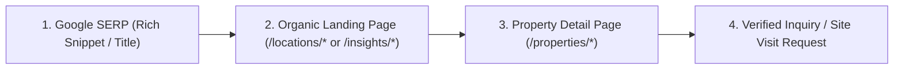

# Phase 3C — Organic Visitor Conversion Journey & Trust Audit

**Project:** Ratiwal Dream Estates  
**Target Domain:** `https://www.ratiwaldreamestates.com/`  
**Strategy Date:** November 10, 2026  
**Auditor & Strategist:** Senior Conversion Rate Optimization (CRO) & Technical SEO Specialist  
**Status:** Audit & Strategic Recommendations (Zero UI Redesign in this Phase)

---

## Executive Summary

Search engine optimization generates qualified organic traffic; conversion architecture transforms that traffic into verified site visits, advisory inquiries, and property transactions. Real estate land acquisition involves high financial commitments and acute buyer anxiety regarding legal approvals, litigation, and on-ground demarcation.

This audit evaluates the organic user journey across the standard acquisition funnel:  
**Google Search Result → Landing Page / Article → Property Detail Page → Inquiry / Accompanied Site Visit.**

---

## 1. Funnel Step-by-Step Diagnostic

### Step 1: Google SERP to Landing Page (First Impression & Click-Through)
- **Current State:**
  - Standardized titles and meta descriptions (Phase 2 & 3A) fit character boundaries and include target keywords and local credentials (`"8+ Years Experience"`, `"Verified Land"`).
  - Schema `FAQPage` and `BreadcrumbList` are active, providing enhanced visual real estate in SERPs.
- **Conversion Friction Identified:**
  - Absence of Google Business Profile (GBP) Knowledge Panel integration for local branded searches.
  - Lack of immediate star rating or transaction count snippets (correctly omitted in Phase 3A to avoid fabricating fake Schema `AggregateRating`).
- **Optimization Recommendation:**
  - Ensure all Meta Titles lead with primary transactional benefit (e.g., `"JDA Approved Plots in Chaksu | Neelkanth Nagar"`).

---

### Step 2: Landing Page Engagement & Trust Building (Browse Phase)
- **Current State on Corridor Pages (`/locations/[slug]`):**
  - High aesthetic quality, clear H1 headings, regional infrastructure timeline, and arterial connectivity tables.
  - Property cards link cleanly to detail pages.
- **Conversion Friction Identified:**
  - **The "Site Visit" Barrier:** Prospective buyers outside Jaipur often hesitate because they assume an inquiry leads to aggressive telemarketing.
  - **Trust Proof Gap:** Testimonials and case studies (`/testimonials/*`) are not prominently cross-promoted inside the location corridor templates. A buyer reading `/locations/jaipur` does not see the real client case study about JDA patta verification in Jaipur.
- **Optimization Recommendation:**
  - Add a lightweight trust callout box within corridor pages highlighting:
    > *"All site visits are accompanied by our Senior Property Advisor with zero sales pressure. We inspect boundary pillars and verify revenue records on ground."*
  - Cross-link relevant local case studies directly below the property grid.

---

### Step 3: Property Detail Page Evaluation (Evaluation Phase)
- **Current State on Property Detail Pages (`/properties/[slug]`):**
  - High-resolution hero imagery, masterplan layouts, verified plot sizes, statutory approval badges (`JDA Approved`, `RERA Registered`).
  - Clear floating contact / WhatsApp action bar.
- **Conversion Friction Identified:**
  - **Static Pricing Labels:** Several property pages state `"Price on Request"`. While standard for upscale land banking, it increases bounce rates among buyers seeking immediate budget qualification.
  - **Downloadable Due Diligence Dossier:** Serious buyers (especially NRIs) want to download a title verification summary or RERA certificate before initiating phone contact.
- **Optimization Recommendation:**
  - Where developer pricing is public, provide realistic starting benchmarks (e.g., `"From ₹18,500 / Sq. Yard"` or indicative budget bands) while preserving `"Price on Request"` for private high-ticket estate parcels.
  - Introduce an "Instant Title Summary Request" button that delivers verified plot dimensions and RERA document numbers via WhatsApp.

---

### Step 4: Inquiry & Site Visit Conversion (Action Phase)
- **Current State:**
  - Contact page (`/contact`) features verified phone (`+91-9929533436`), direct WhatsApp link, email, and office address.
  - Digital visiting card component on homepage provides one-click dialing.
- **Conversion Friction Identified:**
  - The inquiry form does not allow users to specify their preferred site visit date or transportation requirement (accompanied pickup vs meet on site).
- **Optimization Recommendation (For Future Phase):**
  - Streamline the contact form to include a single dropdown:
    `[ ] I want to schedule a physical site visit this week`  
    `[ ] I want a legal document & RERA verification dossier`  
    `[ ] General investment consultation`

---

## 2. Mobile Experience & Responsive Friction Points

Over 70% of organic real estate searches in India occur on mobile devices via Google Chrome.

| Mobile Evaluation Element | Current Behavior | Conversion Friction Level | Strategic Recommendation |
|---|---|:---:|---|
| **Sticky Action Bar** | WhatsApp and Phone call CTA button visible on scroll | **Low (Excellent)** | Maintain sticky tap targets with clear icon contrast |
| **Form Inputs** | Native inputs with appropriate touch targets | **Low** | Ensure `tel` input type triggers numeric keypad on mobile |
| **Document / Layout Zoom** | Pinch-to-zoom on masterplan diagrams | **Medium** | Ensure high-resolution masterplan diagrams can be tapped to expand full-screen on mobile |
| **Font Preload Impact** | 7 WOFF2 font downloads on initial connection | **Medium** | Consolidate to 2 primary font preloads (P2 recommendation) to speed up mobile button responsiveness |

---

## 3. Summary of High-Impact Conversion Wins

1. **Explicit Fiduciary Promise:** Prominently feature the 5-point verification promise on every property page:
   - 30-Year Revenue Search (Jamabandi & Khasra)
   - Statutory Planning Authority Approval (JDA/ADA/CIDCO)
   - Official RERA Project Registration Check
   - Physical Total Station GPS Boundary Demarcation
   - Post-Registry Revenue Mutation (Namantran) Support
2. **Contextual Testimonial Linking:** Cross-link specific client case studies into corresponding location pages to provide undeniable social proof to hesitant buyers.
3. **Friction-Free WhatsApp Path:** Continue prioritizing direct WhatsApp routing, which remains the single highest-converting inquiry channel for Indian real estate buyers.

