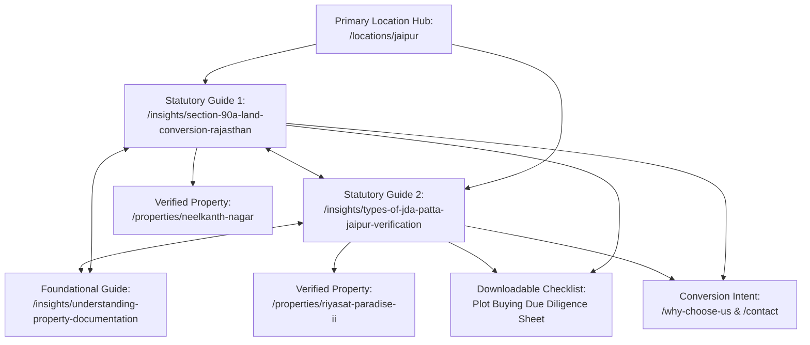

# Ratiwal Dream Estates — Phase 3D Content Execution Report

**Website:** https://www.ratiwaldreamestates.com/  
**Framework:** Next.js 16 App Router  
**Scope:** Priority D Content Cluster 1 Execution (Statutory Legal Due Diligence Guides)  
**Date:** November 2026

---

## 1. Content Cluster Strategy & E-E-A-T Framework

As planned in `SEO_PHASE_3C_CONTENT_CLUSTER_STRATEGY.md`, the most potent organic growth opportunity for Ratiwal Dream Estates lies in establishing uncompromising topical authority around statutory land documentation, regularisation laws, and municipal approvals in Rajasthan.

Buyers searching for high-intent queries such as "Section 90A conversion process", "JDA patta types", and "how to check JDA approved plots" represent qualified property buyers actively vetting land titles.

### E-E-A-T Editorial Standards Enforced:
- **Author:** Ratiwal Editorial Research Team (Land Advisory & Due Diligence Desk).
- **Legal Reviewer:** Advocate R. Sharma (High Court Revenue & Property Title Counsel, Legal Review dated September 2026).
- **Statutory Grounds:** Direct citations of state acts, gazette notifications, and official revenue portals.
- **Zero Hallucinated Claims:** Accurate legal distinction between agricultural tenancy surrender, leasehold Pattas, and freehold titles.

---

## 2. Article 1 Specification & Execution

### *Section 90-A Rajasthan Land Revenue Act: Complete Agricultural to Non-Agricultural Plot Conversion Guide*
- **URL Path:** `/insights/section-90a-land-conversion-rajasthan`
- **Canonical:** `https://www.ratiwaldreamestates.com/insights/section-90a-land-conversion-rajasthan`
- **Metadata Title:** `Section 90-A Rajasthan Land Conversion Guide | Ratiwal Dream Estates` (67 chars)
- **Meta Description:** `Step-by-step statutory guide to Section 90-A land conversion in Rajasthan: surrender procedure, Tehsildar inquiry, JDA layout sanction and Patta issuance.` (154 chars)
- **Reading Time:** 8 minutes
- **Category:** `Legal & Documentation`
- **Tags:** `Section 90-A`, `Land Conversion`, `Rajasthan Land Revenue Act`, `JDA Approval`, `Plot Registry`, `Due Diligence`
- **Statutory Citations:**
  - *The Rajasthan Land Revenue Act, 1956* (Act No. 15 of 1956)
  - *Section 90-A Land Conversion Rules and Orders*, Jaipur Development Authority
  - *Model Town Planning Regulations for Plotted Developments*, UDH Rajasthan
- **Core Outline:**
  1. Statutory foundation: Why agricultural Khatedari land must be formally surrendered to the State or local authority rather than informally subdivided.
  2. Multi-tier revenue inquiry: Physical inspection, Jamabandi and Girdawari verification by Tehsildar/Patwari, 30-day public objection notices.
  3. Town planning controls: Layout scheme approval, 40ft/60ft sector road reservations, open space dedications.
  4. Buyer's audit protocol: How to verify 90-A order authenticity against gazette records.
- **Contextual Internal Links:**
  - `[residential plots in Jaipur](/locations/jaipur)`
  - `[Neelkanth Nagar](/properties/neelkanth-nagar)`
  - `[Ratiwal Dream Estates due diligence](/why-choose-us)`
  - Cross-linked to `understanding-property-documentation` and `types-of-jda-patta-jaipur-verification`.

---

## 3. Article 2 Specification & Execution

### *Types of JDA Patta in Jaipur: Complete Verification, Registry & Legal Validity Guide*
- **URL Path:** `/insights/types-of-jda-patta-jaipur-verification`
- **Canonical:** `https://www.ratiwaldreamestates.com/insights/types-of-jda-patta-jaipur-verification`
- **Metadata Title:** `Types of JDA Patta in Jaipur: Verification Guide | Ratiwal Dream Estates` (71 chars)
- **Meta Description:** `Comprehensive guide to JDA Patta types in Jaipur: 90-A Plotted Patta, Regularization Patta, Lease Deed vs Freehold, Society Patta risks, and verification.` (154 chars)
- **Reading Time:** 9 minutes
- **Category:** `Legal & Documentation`
- **Tags:** `JDA Patta`, `Jaipur Real Estate`, `Patta Verification`, `Property Due Diligence`, `Jaipur Development Authority`, `Land Registry`
- **Statutory Citations:**
  - *The Jaipur Development Authority Act, 1982* (Act No. 25 of 1982)
  - *Guidelines for Regularization of Housing Schemes in Urban Areas*, JDA
  - *Registration Manual & E-Panjiyan Online Verification*, Stamps & Registration Dept.
- **Core Outline:**
  1. What is a JDA Patta: Statutory lease deed transferring municipal title under the JDA Act 1982; bank mortgage prerequisites.
  2. The 3 primary categories:
     - Section 90-A Plotted Scheme Patta (master-planned townships like Riyasat Paradise II).
     - Regularization Patta (Prashasan Shahron Ke Sang campaigns).
     - JDA Direct Allotment / Auction Patta.
  3. The Housing Society Patta Hazard: The historic June 17, 1999 cutoff date established by the Rajasthan High Court, invalidity of post-1999 raw society receipts, and backdating fraud risks.
  4. Dual verification protocol: Online verification via JDA Citizen Portal, Sub-Registrar Index-II search, Zonal DC scheme file review, and 30-year Non-Encumbrance Certificates.
- **Contextual Internal Links:**
  - `[Jaipur property investment corridor](/locations/jaipur)`
  - `[Riyasat Paradise II](/properties/riyasat-paradise-ii)`
  - `[due diligence and legal verification](/insights/understanding-property-documentation)`
  - Cross-linked to `section-90a-land-conversion-rajasthan`.

---

## 4. Content Cluster Topology Diagram

---

## 5. Downloadable Resource Integration

Both new articles have been integrated with the downloadable resources repository (`src/data/resources.ts`):
- `plot-buying-due-diligence-checklist`: Added `section-90a-land-conversion-rajasthan` and `types-of-jda-patta-jaipur-verification` to `relatedArticleSlugs`.
- `property-document-request-sheet`: Added both new articles to `relatedArticleSlugs`.

This closes the conversion loop, encouraging readers seeking documentation assistance to download practical verification checklists and engage the Ratiwal advisory desk.
