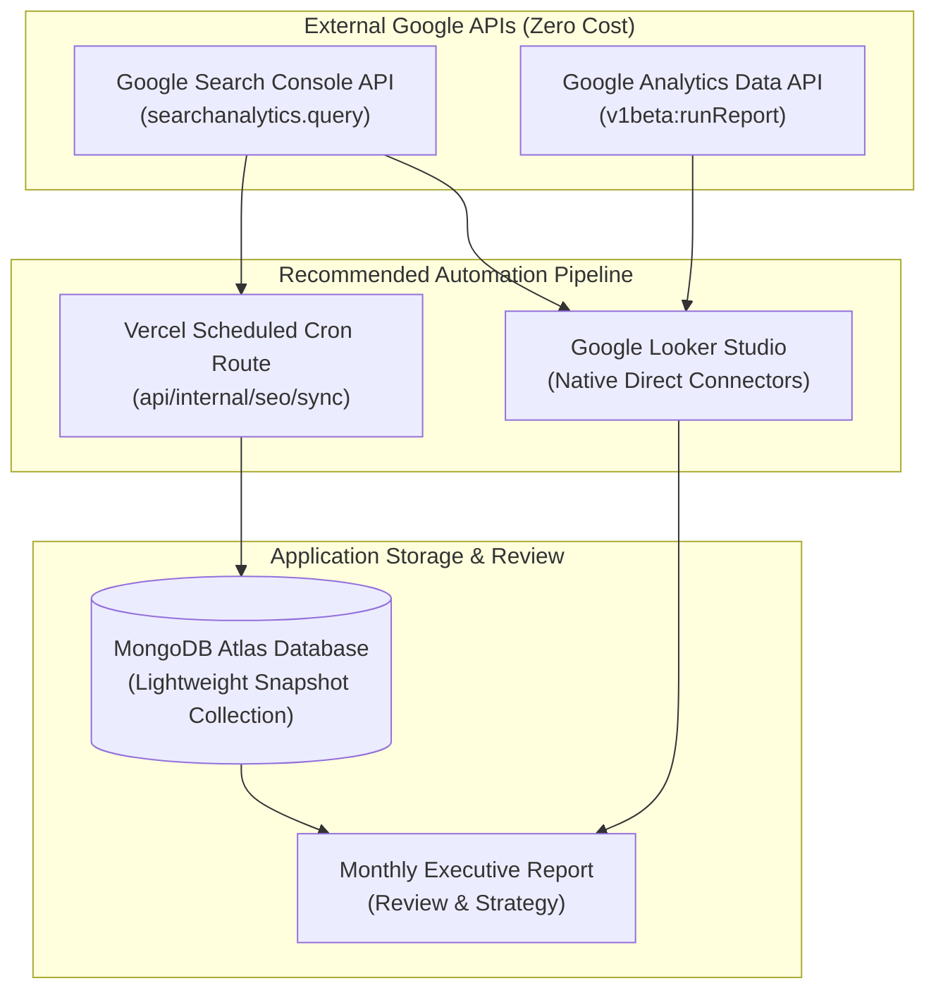

# Ratiwal Dream Estates — Phase 4 Automation Recommendations

**Website:** https://www.ratiwaldreamestates.com/  
**Framework:** Next.js 16 App Router  
**Scope:** Feasibility Analysis of Automated SEO & Analytics Telemetry  
**Date:** November 2026

---

## 1. Automation Feasibility Analysis

Automating SEO monitoring reduces manual reporting overhead while ensuring data consistency over time. In evaluating automation mechanisms for Ratiwal Dream Estates, we assessed four primary integration vectors:

---

## 2. Evaluation of Automated Integration Vectors

### Vector A: Google Looker Studio Dashboard (Recommended — Phase 4.1, Zero Code, Zero Cost)
- **Feasibility:** Very High.
- **Mechanism:** Google Looker Studio provides official, native direct connectors to Google Search Console and Google Analytics 4.
- **Advantages:**
  - **Zero Code:** Requires no Next.js code modifications, no server-side API cron jobs, and no database writes.
  - **Zero Cost:** Looker Studio is completely free under Google Workspace / Google Account services.
  - **Live Visualizations:** Automatically generates interactive time-series charts, impression delta comparisons, device breakdowns, and landing page tables.
  - **Zero Credential Exposure:** Authentication occurs entirely within Google's OAuth UI without storing API keys in application environment variables.
- **Risk:** None.

---

### Vector B: Google Search Console Search Analytics API (Phase 4.2 Candidate — Subject to Approval)
- **Feasibility:** Moderate to High.
- **Mechanism:** A server-side Google Service Account authenticates with read-only Search Console scopes (`https://www.googleapis.com/auth/webmasters.readonly`), executing `searchanalytics.query` on a weekly schedule.
- **Data Retrieved:** Top 250 queries, impressions, clicks, CTR, and average position aggregated weekly.
- **Storage:** Persisted into a lightweight MongoDB collection (`SeoTelemetrySnapshot`) with compound indexes on `{ date: -1, query: 1 }`.
- **Advantages:**
  - Enables in-dashboard SEO widgets inside the existing custom Next.js admin dashboard without leaving the portal.
  - Creates a permanent proprietary archive of search telemetry beyond GSC's 16-month rolling window.
- **Prerequisites & Guardrails:**
  - Requires Google Cloud Project service account creation and domain-level Search Console delegation.
  - Credentials must be stored strictly as server-side private strings (`GSC_SERVICE_ACCOUNT_EMAIL`, `GSC_PRIVATE_KEY`), never exposed via `NEXT_PUBLIC_` variables.

---

### Vector C: Server-Side Scheduled Cron Jobs (App Router Route Handlers)
- **Feasibility:** High.
- **Mechanism:** Next.js Route Handler located at `/api/internal/seo/sync-telemetry` triggered by Vercel Cron on a weekly basis (e.g., every Sunday at 02:00 UTC).
- **Security Guardrails:**
  - Must validate the `Authorization: Bearer ${CRON_SECRET}` header on every request.
  - Returns `401 Unauthorized` for any unauthenticated ping.
  - Sets appropriate execution timeouts (`maxDuration = 60`).

---

### Vector D: Third-Party SERP Scraping (Rejected & Prohibited)
- **Feasibility:** Strictly Prohibited.
- **Analysis:** Using headless browsers (Playwright/Puppeteer) or HTTP scraping proxies to query Google SERPs:
  - Violates Google's Search Essentials and Terms of Service.
  - Triggers Cloudflare, CAPTCHA challenges, and IP blacklisting.
  - Yields inconsistent, non-personalized ranking data.
- **Decision:** **Zero scraping permitted.** All ranking telemetry must originate from official Google APIs or verified third-party API providers with proper terms of service.

---

## 3. Cost & Complexity Matrix

| Mechanism | Monthly Cost | Implementation Effort | Maintenance Burden | Security Risk | Recommendation |
|:---|:---:|:---:|:---:|:---:|:---:|
| **Google Looker Studio** | **$0** | 2 Hours | Minimal | None | **Primary Recommendation (Phase 4.1)** |
| **GSC Search Analytics API** | **$0** | 8 Hours | Low | Low (Service Account) | **Secondary Candidate (Phase 4.2)** |
| **GA4 Data API** | **$0** | 6 Hours | Low | Low (Service Account) | **Secondary Candidate (Phase 4.2)** |
| **Paid Rank Tracker (Ahrefs/SEMrush)** | $99 – $199/mo | 1 Hour | Minimal | None | Optional (If daily fixed rank is required) |
| **SERP Scraping Scripts** | Variable | 20+ Hours | Very High | **Severe (IP Block)** | **Strictly Prohibited** |

---

## 4. Implementation Phasing & Explicit Approvals Required

### Stage 1 (Immediate — Zero Risk):
1. Configure a unified Google Looker Studio dashboard connected directly to the verified Search Console property.
2. Establish the monthly executive report cadence using the Phase 4 template.
- **Approval Required:** None (No code changes required).

### Stage 2 (Client-Side Analytics Integration — Awaiting Approval):
1. Install `@next/third-parties/google` to deploy GA4 cleanly in Next.js 16.
2. Wire micro-conversion event dispatchers to WhatsApp pills and phone buttons.
- **Approval Required:** **Explicit Owner Approval** to configure `NEXT_PUBLIC_GA_MEASUREMENT_ID` and merge client tracking components.

### Stage 3 (In-Dashboard Telemetry Widget — Future Consideration):
1. Create Google Cloud service account with Search Console read-only access.
2. Implement `/api/internal/seo/sync-telemetry` cron job to archive queries in MongoDB.
3. Add a read-only SEO overview tab to `/dashboard/analytics`.
- **Approval Required:** **Explicit Owner Approval** before introducing new dashboard pages or database collections.
