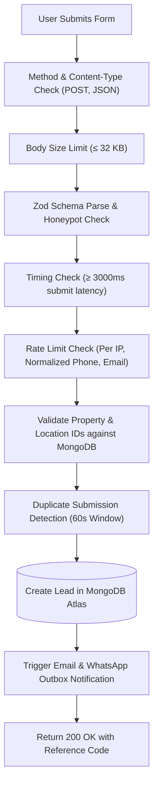

# Ratiwal Dream Estates — Phase 4 Conversion Tracking Audit

**Website:** https://www.ratiwaldreamestates.com/  
**Framework:** Next.js 16 App Router  
**Scope:** Public Conversion Touchpoints, Lead Funnel Audit & Privacy Architecture  
**Date:** November 2026

---

## 1. Executive Summary of Conversion Touchpoints

The commercial success of SEO for Ratiwal Dream Estates depends on capturing qualified real estate interest from organic visitors and routing inquiries into the advisory desk.

Unlike e-commerce transactions, real estate land transactions involve consultative touchpoints. A comprehensive audit of the Next.js 16 App Router codebase reveals **seven critical conversion events**:

| # | Conversion Action | Interface Component | Technical Endpoint / Handler | Primary Commercial Intent |
|:---:|:---|:---|:---|:---|
| 1 | **Property Detail Viewed** | `src/app/(marketing)/properties/[slug]/` | Server-rendered page | Mid-funnel consideration |
| 2 | **Inquiry Form Opened** | `PropertyEnquiry.tsx`, `StickyPropertyInquiry.tsx` | Client UI interaction | High purchase consideration |
| 3 | **Inquiry Form Submitted** | `PropertyEnquiry.tsx`, `ContactFormHub.tsx` | `POST /api/inquiries` | Direct commercial mandate |
| 4 | **WhatsApp Advisory Clicked** | `FloatingWhatsAppButton.tsx`, `generateWhatsAppUrl` | `https://wa.me/919929533436` | Instant mobile consultation |
| 5 | **Direct Phone Call Clicked** | `Header.tsx`, `ContactDirectBar.tsx` | `tel:+919929533436` | Immediate advisory consultation |
| 6 | **Site Visit Requested** | `ContactFormHub.tsx` (Tab 2) | `POST /api/site-visits/requests` | High-intent on-ground physical inspection |
| 7 | **Contact Hub Form Submitted** | `src/app/(marketing)/contact/page.tsx` | `POST /api/enquiries` | General advisory mandate |

---

## 2. Server-Side Lead Pipeline Audit (`/api/inquiries`)

The primary form submission endpoint at [`src/app/api/enquiries/route.ts`](file:///r:/New%20folder/ratiwal-dream-estates/src/app/api/enquiries/route.ts) already executes a robust 13-stage verification pipeline:



### Strengths Identified:
1. **Deduplication Engine:** `DUPLICATE_WINDOW_MS = 60000` prevents accidental double-clicking from inflating lead metrics.
2. **Honeypot & Timing Guards:** Bots submitting forms faster than `MIN_FORM_TIME_MS = 3000` are rejected silently, preventing spam leads.
3. **Controlled Attribution:** The backend strictly assigns `LeadSource` from a controlled enum (`PROPERTY_DETAIL`, `LOCATION_PAGE`, `CONTACT_PAGE`, `ADVISOR_SECTION`), ensuring reliable source reporting.

---

## 3. Client-Side Telemetry Gaps & Unmonitored Actions

While server-side form submissions are recorded reliably in MongoDB, **outbound and off-page conversions currently lack client-side analytics telemetry**:

### The Unmonitored Actions:
1. **WhatsApp Clicks:** Every click on a `wa.me` link navigates the user off-domain to WhatsApp. Currently, no client-side tracking event records:
   - Which page the visitor clicked from (e.g. `/properties/riyasat-paradise-ii` vs `/locations/jaipur`).
   - Which specific button was clicked (Floating FAB vs Hero CTA vs Sticky Footer).
2. **Phone Number Taps:** Mobile taps on `tel:+919929533436` exit the site without triggering any tracking log.
3. **Downloadable Resource Engagement:** Clicks on PDF checklists (e.g. `/documents/plot-buying-due-diligence-checklist.pdf`) are not logged to measure educational content ROI.

---

## 4. Privacy-First Event Tracking Architecture

To close telemetry gaps without compromising user privacy, the following event taxonomy is designed for implementation upon owner approval:

### Strict Privacy Rules:
- **No PII:** Never pass visitor names, phone numbers, or email addresses into analytics payloads.
- **Contextual Attributes Only:** Include only non-sensitive routing data (`page_path`, `property_slug`, `location_name`, `cta_placement`).

### Event Taxonomy Specification:

```typescript
// 1. WhatsApp Click Event (Micro-Conversion)
gtag("event", "click_whatsapp_advisor", {
  event_category: "Engagement",
  event_label: ctaPlacement, // e.g., "floating_fab", "property_sticky_bar", "footer"
  page_path: window.location.pathname,
  property_slug: propertySlug || undefined,
  location_slug: locationSlug || undefined,
});

// 2. Direct Phone Call Tap (Micro-Conversion)
gtag("event", "click_phone_call", {
  event_category: "Engagement",
  event_label: "header_phone_button",
  page_path: window.location.pathname,
});

// 3. Inquiry Form Started (Mid-Funnel)
gtag("event", "inquiry_form_start", {
  event_category: "Lead_Funnel",
  form_type: "property_inquiry", // or "site_visit", "general_contact"
  property_slug: propertySlug,
});

// 4. Inquiry Form Completed (Macro-Conversion)
gtag("event", "generate_lead", {
  event_category: "Lead_Funnel",
  form_type: "property_inquiry",
  property_slug: propertySlug,
  location_slug: locationSlug,
  reference_number_prefix: "RDE-INQ", // Generic prefix only, never PII
});

// 5. Site Visit Request Completed (Macro-Conversion)
gtag("event", "request_site_visit", {
  event_category: "Lead_Funnel",
  property_slug: propertySlug,
  preferred_date: preferredDate, // Date only
});
```

---

## 5. Implementation Recommendations & Next Steps

1. **Adopt Official Next.js Google Analytics Package:**
   - When approved, install and configure `@next/third-parties/google` in `src/app/layout.tsx`.
   - Provide `NEXT_PUBLIC_GA_MEASUREMENT_ID` through environment variables.
2. **Centralize Event Dispatcher:**
   - Create a lightweight helper `src/lib/analytics/events.ts` to enforce uniform event naming and strict PII stripping before dispatching to `window.gtag`.
3. **Wire Event Handlers to Shared UI Components:**
   - Attach onClick handlers to [`src/components/layout/FloatingWhatsAppButton.tsx`](file:///r:/New%20folder/ratiwal-dream-estates/src/components/layout/FloatingWhatsAppButton.tsx) and property action bars.
