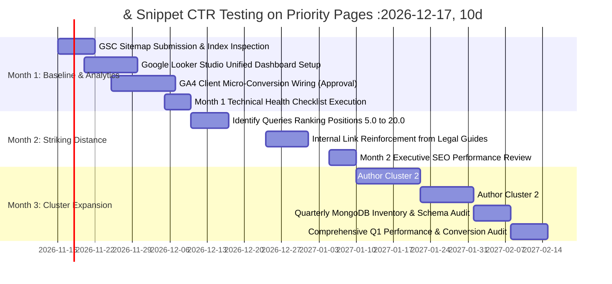

# Ratiwal Dream Estates — Phase 4 Final SEO Roadmap

**Website:** https://www.ratiwaldreamestates.com/  
**Framework:** Next.js 16 App Router  
**Scope:** 12-Week Continuous Optimization, Ranking Growth & Reporting Roadmap  
**Date:** November 2026

---

## 1. 12-Week Strategic Timeline Overview

Following the successful technical foundation (Phase 1), metadata normalization (Phase 2), controlled implementation (Phase 3A), production validation (Phase 3B), growth architecture (Phase 3C), and physical execution (Phase 3D), **Phase 4 establishes an operational 12-week continuous growth cadence**:



---

## 2. Detailed 12-Week Execution Plan

### Month 1: Baseline Data Capture & Telemetry Wiring (Weeks 1 – 4)

- **Week 1: GSC Sitemap Re-submission & New URL Index Inspection**
  - Verify that Google Search Console has successfully fetched `https://www.ratiwaldreamestates.com/sitemap.xml` (39 total URLs).
  - Submit manual index inspection requests for the two new cornerstone guides:
    - `/insights/section-90a-land-conversion-rajasthan`
    - `/insights/types-of-jda-patta-jaipur-verification`
  - Record zero crawl errors and confirm 100% canonical recognition.

- **Week 2: Looker Studio Executive Dashboard Deployment**
  - Establish a unified Google Looker Studio dashboard connected directly to the Search Console domain property.
  - Configure automated weekly email snapshots tracking impressions, clicks, average position, and top landing pages.
  - **Effort:** 2 Hours | **Cost:** $0 | **Approval:** Internal Marketing.

- **Week 3: Client-Side Conversion Telemetry Wiring (Subject to Approval)**
  - Upon receiving explicit owner approval, integrate `@next/third-parties/google` to deploy GA4.
  - Attach non-PII event dispatchers to:
    - WhatsApp buttons (`click_whatsapp_advisor` with context parameters).
    - Phone links (`click_phone_call`).
    - Inquiry form completion (`generate_lead`).
  - **Effort:** 6 Hours | **Approval:** Explicit Owner Sign-off.

- **Week 4: Month 1 Technical Health Audit**
  - Execute `SEO_PHASE_4_TECHNICAL_HEALTH_CHECKLIST.md`.
  - Validate that mobile Core Web Vitals field data reflects the font preload optimization (~150 KB freed).
  - Compile the first Month 1 SEO Executive Report using the standardized template.

---

### Month 2: Striking-Distance Query Optimization & CTR Refinement (Weeks 5 – 8)

- **Week 5: GSC Striking Distance Audit (Positions 5.0 – 20.0)**
  - Filter GSC search query report for queries with average position between 5.0 and 20.0 and impressions > 100.
  - Map high-volume opportunities (e.g., "plots in tonk road jaipur", "jda approved commercial plots ajmer").

- **Week 6: Snippet & CTR A/B Testing**
  - Evaluate search result snippets for striking distance pages.
  - Refine meta descriptions using `fitMetaText()` to incorporate specific value propositions (e.g., "JDA Sanctioned", "30-Year Title Search", "Immediate Registry").
  - **Approval:** Explicit Owner Approval before updating metadata copy.

- **Week 7: Contextual Internal Link Reinforcement**
  - Review the two published legal guides and existing articles.
  - Strengthen deep anchor text links pointing from legal guides to underperforming property inventory pages (`/properties/happy-business-park`, `/properties/one-kishangarh`).

- **Week 8: Month 2 Executive SEO Review**
  - Evaluate CTR shift on optimized pages.
  - Review organic lead volume in MongoDB Atlas against baseline.
  - Deliver Month 2 Performance Report to leadership.

---

### Month 3: Content Expansion & Quarterly Technical Re-Audit (Weeks 9 – 12)

- **Week 9: Author Cluster 2 Guide — *Jaipur Ring Road Plotted Corridor***
  - Research and author an authoritative guide covering the 47-km southern Ring Road corridor connecting Ajmer Road, Diggi Malpura Road, and Tonk Road.
  - Connect corridor growth drivers with active projects (Neelkanth Nagar, Riyasat Paradise II).
  - **Approval:** Legal and Strategy review before publishing.

- **Week 10: Author Cluster 2 Guide — *JDA Zonal Jurisdiction & Masterplan 2025***
  - Author a practical investor reference explaining JDA Zones 1 through 14, zonal offices, and masterplan land-use zoning.
  - Provide actionable guidance for verifying plot status at zonal DC offices.

- **Week 11: Quarterly MongoDB & Static Fallback Reconciliation**
  - Verify that any newly onboarded or sold-out properties in MongoDB Atlas are accurately mirrored in static fallback files and sitemap.
  - Re-run automated unit tests (`scripts/test-seo-metadata.ts`) and TypeScript guards (`npx tsc --noEmit`).

- **Week 12: Comprehensive Q1 SEO Growth Audit**
  - Deliver a quarterly retrospective comparing pre-Phase 1 baselines against post-Phase 4 results.
  - Review organic lead attribution and calculate organic cost-per-inquiry efficiency.

---

## 3. Governance Gates & Approval Protocol

To maintain project integrity, the following approval boundaries remain in effect:

```
+──────────────────────────────────────────────────────────────────────────────────────────+
| ACTION CATEGORY                             | PERMISSIBLE WITHOUT APPROVAL? | REQUIRED GATE |
+──────────────────────────────────────────────────────────────────────────────────────────+
| Recurring Technical Health Checks           | YES (Diagnostic only)         | Standard Ops  |
| Looker Studio Dashboard Connection         | YES (Zero code modifications) | Marketing Lead|
| Minor Meta Title / Description Updates      | NO                            | Owner Review  |
| Deploying GA4 Client-Side Analytics         | NO                            | Owner Review  |
| Adding New Content Guides to insights.ts    | NO                            | Legal & Owner |
| Modifying Database Schemas or Models        | NO                            | Tech Lead     |
| Introducing New Dashboard Pages             | NO                            | Owner Review  |
+──────────────────────────────────────────────────────────────────────────────────────────+
```

