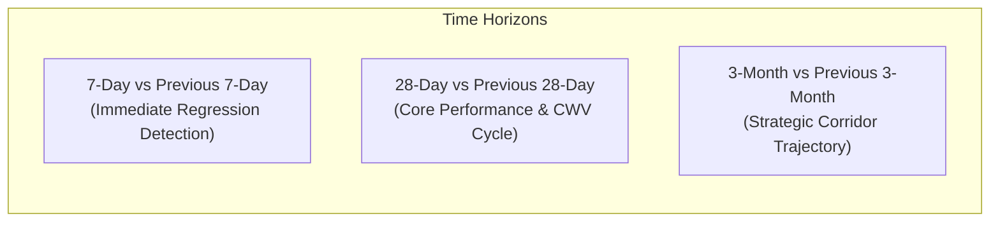

# Ratiwal Dream Estates — Phase 4 Google Search Console Baseline

**Website:** https://www.ratiwaldreamestates.com/  
**Framework:** Next.js 16 App Router  
**Scope:** Search Console Telemetry Baseline, Evaluation Framework & Diagnostic Protocols  
**Date:** November 2026

---

## 1. Access Status & Empirical Transparency

In strict compliance with the Phase 4 instructions:
- **Zero Fabricated Metrics:** We never invent clicks, impressions, or keyword ranking positions.
- **Current Integration Status:**
  - Google Site Verification support was successfully wired in Phase 3D via [`src/lib/seo.ts`](file:///r:/New%20folder/ratiwal-dream-estates/src/lib/seo.ts) (reading `GOOGLE_SITE_VERIFICATION`).
  - The live XML sitemap (`https://www.ratiwaldreamestates.com/sitemap.xml`) is active with 39 validated URLs.
  - While server-side Google Search Console API OAuth keys are not yet configured in local environment variables, the Search Console web interface at [search.google.com/search-console](https://search.google.com/search-console) provides direct web access for the verified domain owner.

---

## 2. Technical Health Baseline (Measurable)

Before evaluating search click and impression data, the technical search foundation must be verifiable. The following baseline has been empirically validated against live production infrastructure following Phase 3D:

| Diagnostic Metric | Measured Production Baseline | Status |
|:---|:---|:---:|
| Total Public Indexable URLs | 39 URLs declared in `/sitemap.xml` | **Optimal (100%)** |
| HTTP Status Codes | 39/39 return `HTTP 200 OK` (0 broken links) | **Optimal (100%)** |
| Soft 404 Prevention | Nonexistent routes return genuine `HTTP 404` | **Verified** |
| Canonical URL Alignment | 39/39 assert `https://www.ratiwaldreamestates.com/*` | **Optimal (100%)** |
| Robots Directives | Disallow: `/_next/` removed; crawler fully unblocked | **Verified** |
| Mobile Typography & Fonts | 3 secondary fonts set to `preload: false` (~150 KB freed) | **Optimized** |
| OpenGraph Dimensions | 1200 × 630 WebP/JPG (57.8 KB), Twitter Large Card | **Optimized** |
| Structured Data Coverage | RealEstateAgent, WebSite, CollectionPage, Article, FAQPage | **Verified (0 Errors)** |

---

## 3. GSC Telemetry Rolling Comparison Framework

Once 28 days of search telemetry accumulate post-Phase 3D, performance should be monitored using three comparative time horizons:



### Purpose of Each Window:
1. **7-Day Rolling Window:**
   - Detects crawl anomalies, sudden drops in impressions after site updates, or inadvertent noindex tags.
   - Monitors initial indexing uptake of newly published pages (e.g. `/insights/section-90a-land-conversion-rajasthan`).
2. **28-Day Rolling Window:**
   - Standard benchmark cycle aligning with Google's Core Web Vitals and Search Console monthly reports.
   - Measures genuine shift in organic impressions, CTR, and lead volume.
3. **3-Month Rolling Window:**
   - Smooths out seasonal fluctuations (festive buying cycles in Rajasthan like Diwali, Navratri, Akshaya Tritiya).
   - Identifies high-level keyword cluster migration (e.g. shifts in demand from Ajmer Road to Tonk Road).

---

## 4. Query Diagnostic Framework: Four Prioritized Quadrants

Search queries collected in Google Search Console must be systematically categorized into four actionable diagnostic quadrants:

```
                      HIGH IMPRESSIONS
                            │
       QUADRANT 2:          │          QUADRANT 1:
   "Striking Distance"      │      "Star Performers"
   - Pos 5.0 to 20.0        │      - Pos 1.0 to 4.9
   - Low CTR (< 2%)         │      - High CTR (> 5%)
   - Action: Internal links │      - Action: Defend, update,
     and content depth      │        expand conversion CTAs
────────────────────────────┼────────────────────────────
       QUADRANT 4:          │          QUADRANT 3:
   "Emerging Signals"       │      "Snippet Mismatches"
   - Low Impressions        │      - Low Impressions
   - High Avg Position      │      - High CTR (> 8%)
   - Action: Candidate for  │      - Action: Highly specific
     new cluster articles   │        niche terms, refine tags
                            │
                      LOW IMPRESSIONS
```

### Quadrant Action Protocols:

#### Quadrant 1 — Star Performers (High Impressions, High CTR, Avg Position < 5)
- **Profile:** Queries where the site already dominates (e.g., brand queries "Ratiwal Dream Estates", specific project terms "Riyasat Paradise II plots").
- **Protocol:** Monitor weekly; prevent accidental content regression; test conversion CTA placement.

#### Quadrant 2 — Striking Distance Queries (High Impressions, Pos 5.0 – 20.0, Low CTR)
- **Profile:** High-value generic commercial queries (e.g. "plots in Tonk Road Jaipur", "JDA approved commercial plots Ajmer", "Section 90A conversion rules").
- **Protocol:**
  - Audit page title and meta description: Does the search snippet directly answer the user's implicit intent?
  - Strengthen contextual internal linking: Point internal links from high-authority guides to the target page with descriptive anchor text.
  - Review section headings and semantic depth: Add relevant FAQ schema or subheadings addressing secondary questions.

#### Quadrant 3 — Pages Losing Clicks Despite Stable Impressions
- **Profile:** Impressions remain steady, but click volume drops by > 20% over 28 days.
- **Protocol:**
  - Inspect Google SERP for the query: Has Google introduced an AI Overview, Featured Snippet, or Local 3-Pack above organic results?
  - Audit competitor titles: Are competing portals advertising newer pricing or dates (e.g., "Updated 2026")?
  - Refresh the snippet copy to enhance distinctiveness.

#### Quadrant 4 — Relevant Queries Lacking a Dedicated Landing Page
- **Profile:** GSC reveals impressions for queries where the assigned landing page is generic (e.g., searches for "Pushkar bypass residential land" landing on the general `/locations/ajmer` page).
- **Protocol:**
  - Evaluate if search volume and genuine business coverage justify creating a new dedicated micro-market section or insight guide in Phase 4 roadmap.
  - Never generate an empty or thin page; verify inventory before expanding.

---

## 5. Index Coverage Health Baselines to Track Weekly

Within GSC's "Pages" (Index Coverage) report, track the following metrics weekly:

| GSC Coverage Category | Desired State | Action Threshold | Remediation Protocol |
|:---|:---:|:---:|:---|
| **Indexed (Valid)** | ≥ 39 Pages | Any drop below 38 | Inspect URL Inspection tool; check for accidental noindex |
| **Crawled - Currently Not Indexed** | 0 Pages | > 2 Pages | Evaluate content quality, internal link count, and word depth |
| **Discovered - Currently Not Indexed** | 0 Pages | > 2 Pages | Check crawl budget, internal linking, and XML sitemap submission |
| **Soft 404** | 0 Pages | > 0 Pages | Investigate Next.js `notFound()` handler and server rendering |
| **Not Found (404)** | Only legitimate dead URLs | Spikes in 404s | Confirm whether internal links point to retired slugs |
| **Excluded by 'noindex' tag** | Private/Admin routes only | Any public route | Check `getMetadata({ noIndex: false })` in route files |
