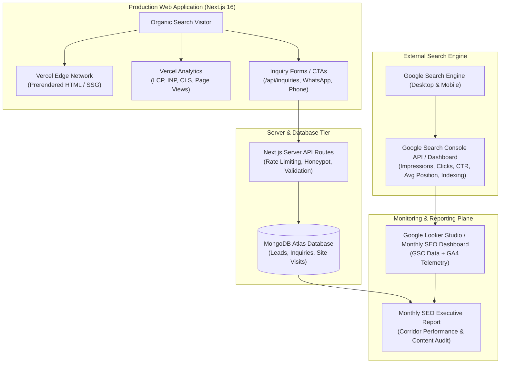

# Ratiwal Dream Estates — Phase 4 SEO Monitoring Architecture

**Website:** https://www.ratiwaldreamestates.com/  
**Framework:** Next.js 16 App Router  
**Phase:** Phase 4 — SEO Monitoring, Ranking Growth & Continuous Optimization  
**Author:** Senior SEO Growth Manager & Next.js Analytics Specialist  
**Status:** Architecture Specification & Implementation Plan  
**Date:** November 2026

---

## 1. System Objective & Design Principles

The primary objective of the Phase 4 Monitoring Architecture is to establish an empirical, sustainable, and privacy-compliant SEO measurement infrastructure for Ratiwal Dream Estates.

Rather than relying on speculative claims, third-party scraping, or unverified keyword rank trackers, the architecture bridges three authoritative data planes:
1. **Google Search Visibility Plane:** Organic impressions, clicks, click-through rates (CTR), average query positions, and indexation telemetry from Google Search Console.
2. **On-Site User Experience & Performance Plane:** Real User Monitoring (RUM) Core Web Vitals, page transitions, and session telemetry from Vercel Analytics.
3. **Business Lead & Conversion Plane:** Validated inquiry submissions, WhatsApp advisory consultations, phone inquiries, and site visit bookings captured securely in the MongoDB Atlas database.

### Strict Non-Negotiable Constraints:
- **No Scraping:** Zero automated scraping of Google Search Result pages (violates Google Search Essentials and Terms of Service).
- **No Speculative Ranking Guarantees:** Search rankings cannot be guaranteed; all reporting reflects empirical search telemetry.
- **Strict Data Privacy:** Zero Personally Identifiable Information (PII)—such as names, phone numbers, or email addresses—is passed to client-side analytics trackers.
- **Server-Side Credential Isolation:** All API credentials, service account secrets, and database connections remain strictly isolated in server environments, never exposed via `NEXT_PUBLIC_` variables.

---

## 2. Comprehensive Data Flow Architecture

---

## 3. Data Source Specifications

### A. Google Search Console (GSC)
- **Role:** Source of truth for organic search demand, crawler indexing, and search appearance.
- **Data Extracted:**
  - Aggregated search queries (filtered by page, country, and device).
  - Search impressions, clicks, click-through rate (CTR), and average position.
  - Sitemap processing status (`https://www.ratiwaldreamestates.com/sitemap.xml`).
  - Index coverage status (Valid pages, Discovered - currently not indexed, Crawled - currently not indexed, 404s).
  - Mobile usability and Core Web Vitals field data.
- **Telemetry Windows:**
  - 7-day rolling window: Quick regression detection following content or technical releases.
  - 28-day rolling window: Month-over-month trend analysis (aligns with Google's Core Web Vitals aggregation cycle).
  - 3-month rolling window: Macro search corridor trajectory and keyword cluster movement.

### B. Vercel Analytics & Web Vitals
- **Role:** Continuous Real User Monitoring (RUM) for field Core Web Vitals.
- **Data Extracted:**
  - Largest Contentful Paint (LCP): Threshold ≤ 2.5s.
  - Interaction to Next Paint (INP): Threshold ≤ 200ms.
  - Cumulative Layout Shift (CLS): Threshold ≤ 0.1.
  - First Input Delay (FID) / First Contentful Paint (FCP).
- **Integration Status:** Active in production via `@vercel/analytics/next` within [`src/app/layout.tsx`](file:///r:/New%20folder/ratiwal-dream-estates/src/app/layout.tsx).

### C. Internal Lead & Conversion Database (MongoDB Atlas)
- **Role:** Ground-truth validation of commercial intent and lead generation.
- **Data Extracted:**
  - Inquiries by Source (`LeadSource` enum: `PROPERTY_DETAIL`, `PROPERTY_CARD`, `LOCATION_PAGE`, `HOMEPAGE_CTA`, `CONTACT_PAGE`, `ADVISOR_SECTION`).
  - Site visit appointment requests by corridor.
  - Time-to-first-response and advisor workload distributions.
- **Storage:** Models [`Lead`](file:///r:/New%20folder/ratiwal-dream-estates/src/models/Lead.ts), [`Inquiry`](file:///r:/New%20folder/ratiwal-dream-estates/src/models/Inquiry.ts), and [`SiteVisit`](file:///r:/New%20folder/ratiwal-dream-estates/src/models/SiteVisit.ts).

---

## 4. Proposed Google Analytics 4 (GA4) Architecture (Awaiting Approval)

To capture micro-conversion events (such as WhatsApp clicks and outbound calls) that do not reach the server API routes, a lightweight, privacy-focused GA4 or Google Tag Manager (GTM) deployment is recommended:

### Integration Rules:
1. **Zero Layout Shift:** Load asynchronously using Next.js official `@next/third-parties/google` package (`GoogleAnalytics` component).
2. **Privacy by Default:** Enable IP anonymization, disable advertising features / user ID tracking unless explicit consent is provided, and never collect personal identifiers.
3. **Discrete Event Taxonomy:**
   - `view_property`: Fired on `/properties/[slug]` with parameters `{ property_slug, property_type, city }`.
   - `view_location`: Fired on `/locations/[slug]` with parameter `{ location_slug }`.
   - `click_whatsapp_advisor`: Fired when a visitor clicks any `wa.me` advisory button, tagged with `{ context_page, property_or_location }`.
   - `click_phone_call`: Fired when a visitor taps `tel:+919929533436`.
   - `submit_inquiry`: Fired upon successful 200 OK response from `/api/inquiries`.
   - `submit_site_visit`: Fired upon successful submission of a physical site visit request.

---

## 5. Security & Credential Governance

| Credential Type | Environment Variable | Scope | Storage Location | Exposure Risk |
|:---|:---|:---|:---|:---|
| Google Site Verification | `GOOGLE_SITE_VERIFICATION` | Public Meta Tag | Vercel Environment Variables | Low (Public verification token) |
| GSC API Service Account Key | `GOOGLE_GSC_SERVICE_ACCOUNT_KEY` | Server-Side Only | Vercel Server Secrets (Never committed) | High (Restricted to read-only Search Console API) |
| GA4 Measurement ID | `NEXT_PUBLIC_GA_MEASUREMENT_ID` | Client-Side Tag | Vercel Public Environment Variables | None (Standard public tracker ID) |
| MongoDB Atlas URI | `MONGODB_URI` | Server-Side Only | Vercel Server Secrets / `.env.local` | Critical (Full DB isolation) |
| Internal Cron Secret | `CRON_SECRET` | Server-Side Only | Vercel Server Secrets | Critical (Guards scheduled audit routes) |

---

## 6. Implementation Phasing

- **Phase 4.1 (Immediate Architecture & Audits):** Deliver the 8 monitoring specifications, establish the GSC baseline, audit existing conversion events, and configure the technical health checklist. (Zero code changes to core logic).
- **Phase 4.2 (Client Integration - Subject to Approval):** Add GA4 via `@next/third-parties/google`, wire non-PII micro-conversion events, and establish the Looker Studio dashboard.
- **Phase 4.3 (Automated Server Telemetry - Subject to Approval):** Implement a daily/weekly server-side cron job utilizing the official Google Search Console API to archive impressions and queries directly into a lightweight MongoDB collection.
