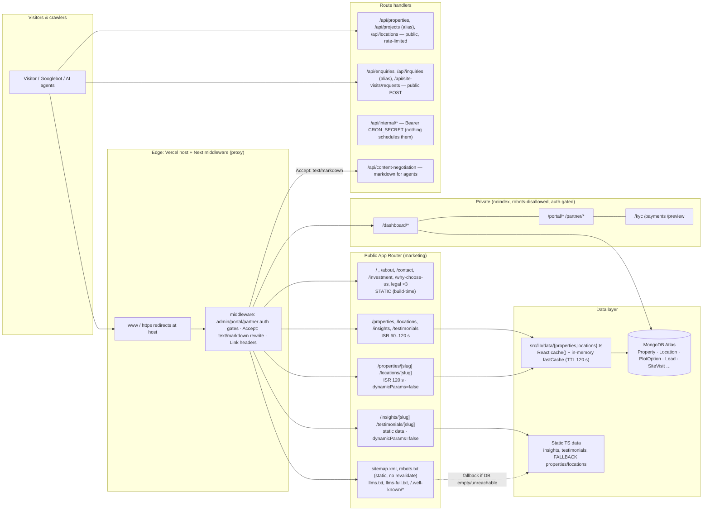

# Phase 6 — Architecture Audit (6A)

**Date:** 2026-11-11 · **Stage:** 6A audit only. **No code, route, schema, data or configuration was changed.**
Evidence: **E-code** = read from the repository; **E-build** = Next build manifests; **E-probe** = measured against a local production build (`next start`) of the current working tree; **E-prod** = public production GETs. ⚠️ The current working tree contains uncommitted changes (loading-boundary removal, heading fixes, SEO dashboard); **production still runs the earlier build** (its HTML still shows the "Loading Ratiwal Dream Estates…" wrapper), so probe results describe the *next* deploy, not today's production, unless stated.

## 1. Current architecture

### 1.1 Public route inventory (E-code, E-build)
| Route | Rendering | Revalidation | Dynamic params |
|---|---|---|---|
| `/`, `/about`, `/contact`, `/investment`, `/why-choose-us`, `/privacy-policy`, `/terms-of-service`, `/disclaimer` | static | `/` ISR 60 s; others build-time only | — |
| `/properties` | ISR (static shell + client filter) | 60 s | — |
| `/locations`, `/insights`, `/testimonials` | ISR | 120 s | — |
| `/properties/[slug]` | ISR, 9 prerendered | 120 s | **`dynamicParams=false`** (manifest `fallback:false`) |
| `/locations/[slug]` | ISR, 6 prerendered | 120 s | **`dynamicParams=false`** |
| `/insights/[slug]`, `/testimonials/[slug]` | static (8 + 4) | none | `dynamicParams=false` |
| `/sitemap.xml`, `/robots.txt` | static | **`revalidate:false`** | — |

### 1.2 Metadata architecture (E-code)
Single factory `getMetadata()` (`src/lib/seo.ts`) → title template `"<title> | Ratiwal Dream Estates"`, self-referencing canonical built from `siteConfig.url` + slug, OG + Twitter, robots with `max-image-preview:large`, optional Google verification. Root layout uses `omitCanonical`/`omitRobots` so private pages never inherit the homepage canonical (good). Property/location pages build metadata in `generateMetadata` from DB records (with SEO overrides).

### 1.3 Structured data (E-code, E-probe) — see Schema Architecture
Two parallel generators exist: `src/components/seo/JsonLd.tsx` (`getRealEstateAgentSchema`, …) and `src/lib/schema.ts` (`buildRealEstateAgentSchema`, …), plus inline `@graph` objects in page files (the property page builds its own `Place`/`RealEstateListing`). Three places can emit the same concepts.

### 1.4 Publishing workflow (E-code)
Admin publish/unpublish/archive/slug-change actions (`property.actions.ts`) write MongoDB, log audit events and call `invalidatePropertyCache()` — an **in-memory, per-instance** cache clear. They do **not** call `revalidatePath`/`revalidateTag`. CMS (articles/locations via `cms-publishing.service.ts`) does call `revalidatePath` for `/locations`, `/insights` and `/sitemap.xml`, so the two workflows behave differently.

### 1.5 Internal navigation (E-probe)
Header and footer expose the main pages; project and location pages are reached through hubs and cards. Raw-HTML crawl depth from `/`: depth 1 = 16 URLs, depth 2 = 18, depth 3 = 3, depth 4 = 1; **0 orphans**.

### 1.6 Search and filtering (E-code)
`/properties` loads every published property into the page payload and filters/sorts/paginates **entirely in client state** (`PropertiesFilterSection`): text search, city, type, status, sort, 12-at-a-time "load more" (auto-loads on scroll). No URL state. `/api/properties` (alias `/api/projects`) filters in memory over the full cached list.

### 1.7 Tests and CI (E-code)
~30 `test:*` npm scripts (scripts/*.ts, run manually; they hit the real database in several cases) including `test-seo-metadata` (28 checks), `test-agent-readiness`, and the Phase 4A suites (160 checks). **No `.github/` directory, no CI configuration, no aggregate `test` script, no pre-deploy SEO gate.**

## 2. Summary of weaknesses (details in the other Phase 6 reports)

| ID | Severity | Weakness | Evidence |
|---|---|---|---|
| V1 | **High** | A **newly published property or location 404s until the next deploy**, while the ISR listing page can link to it within 60 s; unpublish/slug change leave stale static pages and a frozen sitemap | E-build manifest `fallback:false`; E-code (no `revalidatePath`); not reproduced by publishing (would write to the database) |
| V2 | **High** | If MongoDB is unreachable **at build time**, `generateStaticParams()` swallows the error and returns `[]`, so **zero property/location pages are generated and the build still succeeds** | E-code (`catch { return [] }`); not reproduced |
| V3 | High | **Markdown content negotiation returns the homepage markdown for every page** when requested via `Accept: text/markdown` (the rewrite loses the `path` parameter); calling the API directly returns correct distinct content | E-probe: 5 paths → identical 2,085-byte body vs 5 distinct bodies direct |
| V4 | Medium | Sitemap is frozen at build; static pages' `lastmod` equals build time (21 distinct values over 39 URLs, 12 inside one minute) | E-probe |
| V5 | Medium | **Static fallback data defines six properties that do not exist in the database** (e.g., "royal-palms-township-ajmer-road-jaipur"); sitemap, llms files and markdown fall back to them if the DB is empty/unreachable | E-code; llms files currently serve DB data (E-probe) |
| V6 | Medium | Property schema/map coordinates are the **city centroid** (identical to the location's), `streetAddress` is the locality name, and a hard-coded default coordinate is used when none exists | E-probe, E-code |
| V7 | Medium | Weak internal linking: `/locations/kishangarh`, `/locations/panvel`, the 4 case studies and the 2 newest legal guides each have **one** inbound link; `types-of-jda-patta…` sits at depth 4 | E-probe |
| V8 | Medium | Whole catalogue serialised into the page (~2.2 KB per property → ≈1 MB at 500, ≈10 MB at 5,000); API loads everything then filters in memory; `search` is unbounded and used in the cache key | E-probe |
| V9 | Low | `/properties/NEELKANTH-NAGAR` returns 200 (canonical → lowercase) while `/Properties` returns 404 | E-probe |
| V10 | Low | `Vary: Accept` is set in middleware but absent on HTML responses | E-probe |
| V11 | Low | Public API and HTML expose MongoDB ObjectIds (`id`) | E-probe |
| V12 | Policy | `robots.ts` comment says AI *training* is disallowed, but GPTBot, ClaudeBot and Google-Extended are all `Allow: /` | E-code |
| V13 | Info | No CI / no pre-deploy SEO gate | E-code |

## 3. What is healthy (E-probe on the local build)
39/39 sitemap URLs return 200; every page has a self-referencing canonical; every page is `index, follow`; OG title/image and Twitter card present on 39/39; titles ≤ 60 characters and descriptions 70–170 characters on all 39 (after decoding entities); **no duplicate titles**; JSON-LD parses everywhere with no duplicate definitions; trailing-slash and `//` URLs 308 to the clean path; unknown slugs, `/Properties`, `/index.html`, `/home` return 404 with `noindex`; `?utm_`, `?city=`, `?page=`, `?search=` variants return 200 with the canonical pointing at the clean URL; private routes carry `noindex, nofollow`, no-store caching, and `robots.txt` disallows them; no unpublished record reaches the public API, sitemap or location listing (the one DRAFT location returns 404 and is absent from the API and sitemap); production redirects non-www → www and http → https with 308 (E-prod).

## 4. Security and data-quality checks (§9)
| Check | Result |
|---|---|
| Unpublished records via public APIs/pages | ✅ none exposed (the database holds 9 published properties and 0 unpublished, so the **property** case was not exercised; the DRAFT **location** case was) |
| Dashboard protection | ✅ unauthenticated → 307 to login; noindex |
| Rate limiting on search endpoints | 🟡 120 requests/min/IP on `/api/properties`; the client IP is taken from `x-forwarded-for` (trustworthy only behind a proxy that sets it), and the limiter is in-memory per instance |
| Search input validation | 🟡 `page`/`limit` are clamped; `city/type/search` are not length-limited (5,000-char search accepted); hostile operator-style params returned an empty result, no error |
| Query construction | ✅ filtering is in JavaScript after a fixed Mongo query; no user text reaches a Mongo operator |
| Customer data in public HTML/schema | ✅ none found; only the business email, which is public by design |
| Internal IDs/secrets | 🟡 ObjectIds appear (9 on `/properties`, 12–19 on detail/location pages); no secrets |

## 5. Approvals
Nothing here is applied. Recommendations require approval per the roadmap.
