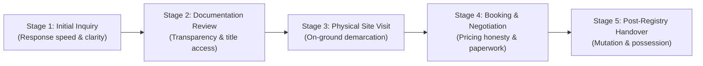

# Ratiwal Dream Estates — Phase 8 Customer Feedback Architecture

**Website:** https://www.ratiwaldreamestates.com/  
**Framework:** Next.js 16 App Router  
**Scope:** Workstream 8B — Multi-Stage Customer Experience & Feedback Lifecycle  
**Date:** November 2026

---

## 1. Architectural Philosophy: Respectful, Staged Feedback

Customer feedback in real estate must be collected at logical milestones rather than overwhelming prospects with aggressive surveys. 

The architecture establishes **5 distinct feedback checkpoints** aligned with the buyer journey:



---

## 2. Five-Stage Feedback Model

### Stage 1: Initial Inquiry & Advisory Consultation
- **Trigger:** 24–48 hours after an inquiry form or WhatsApp consultation is completed.
- **Delivery Channel:** Lightweight WhatsApp Interactive Message or SMS survey link.
- **Key Questions:**
  1. "Did our advisor provide the specific plot information and pricing you were looking for?" (Yes / Partially / No)
  2. "How would you rate the speed and helpfulness of our team?" (1 to 5 Stars)
- **Primary Purpose:** Catch unresponsive or unprofessional advisor interactions within hours.

### Stage 2: Documentation & Due Diligence Experience
- **Trigger:** Delivered when an advisor shares scheme maps, 90-A orders, or RERA certificates.
- **Key Questions:**
  1. "Were all legal documents, sector road widths, and government approvals clearly explained?"
  2. "Did you experience any ambiguity regarding total costs (PLC, registry, development levies)?"
- **Primary Purpose:** Ensure 100% pricing and documentation transparency.

### Stage 3: On-Ground Physical Site Visit Experience
- **Trigger:** 2 hours after a scheduled site visit appointment concludes.
- **Key Questions:**
  1. "Did the on-ground plot boundaries and sector roads match what was described online?"
  2. "How was your experience with our site coordinator?"
  3. "Do you have any pending technical or legal questions regarding this township?"
- **Primary Purpose:** Evaluate ground infrastructure truthfulness and advisor field conduct.

### Stage 4: Booking & Token Experience
- **Trigger:** Upon execution of an allotment or advance booking agreement.
- **Key Questions:**
  1. "Was the booking agreement terms and refund/cancellation policy clearly communicated?"
  2. "Did you feel pressured at any point during your decision?"
- **Primary Purpose:** Enforce a zero-pressure sales culture.

### Stage 5: Post-Transaction & Possession Handover (Advocacy Stage)
- **Trigger:** 30 days after Sub-Registrar registration and revenue mutation filing.
- **Key Questions:**
  1. "How satisfied are you with the complete land acquisition process with Ratiwal Dream Estates?"
  2. "Would you recommend our advisory to friends or family investing in Rajasthan land?" (NPS: 0–10)
  3. "Would you like to share your experience as a verified client testimonial?" (Explicit opt-in)
- **Primary Purpose:** Identify brand advocates and request official Google Business Profile reviews.

---

## 3. Data Specification & Schema Proposal (`CustomerFeedback`)

```typescript
export interface CustomerFeedbackDoc {
  _id: string;
  leadId?: string; // Reference to internal Lead model
  propertyId?: string; // Reference to Property model
  locationId?: string; // Reference to Location model
  
  lifecycleStage: "INITIAL_INQUIRY" | "DOCS_REVIEW" | "SITE_VISIT" | "BOOKING" | "POST_REGISTRY";
  
  rating: number; // 1 to 5 numeric score
  npsScore?: number; // 0 to 10 for post-registry
  
  sentimentCategory: "POSITIVE" | "NEUTRAL" | "NEGATIVE" | "CRITICAL_ISSUE";
  feedbackThemes: Array<"RESPONSE_TIME" | "DOCUMENTATION_CLARITY" | "PRICING_TRANSPARENCY" | "SITE_CONDITION" | "ADVISOR_CONDUCT">;
  
  customerNotes?: string; // Raw qualitative text
  advisorNotes?: string; // Internal operational follow-up
  
  resolutionStatus: "RESOLVED" | "UNDER_REVIEW" | "ESCALATED_TO_FOUNDER" | "CLOSED";
  resolutionLog?: Array<{
    timestamp: Date;
    author: string;
    actionTaken: string;
  }>;
  
  // Strict Consent & Publication Boundaries
  consentToPublish: boolean; // Default FALSE
  consentScope?: {
    allowFullName: boolean;
    allowLocation: boolean;
    allowPropertyMention: boolean;
  };
  
  createdAt: Date;
  updatedAt: Date;
}
```

---

## 4. Security, Privacy & Anti-Spam Architecture

1. **Explicit Consent Barrier:**
   Private feedback submitted by customers is stored strictly in server-side collections. It is **never automatically published** to the website frontend or injected into public testimonials without a separate, written verification audit.
2. **Data Minimization:**
   Feedback forms require zero sensitive financial or banking details. Only sentiment, operational ratings, and qualitative observations are stored.
3. **Duplicate Submission Protection:**
   Submissions are guarded by client session tokens and rate limits (maximum 1 feedback submission per phone number per lifecycle milestone).
4. **Role-Based Access Control (RBAC):**
   Feedback responses indicating dissatisfaction (Ratings 1 or 2, or sentiment `CRITICAL_ISSUE`) trigger an immediate alert to the Principal Advisor (`suresh-kumawat`), bypassing sales staff to ensure unbiased investigation.
