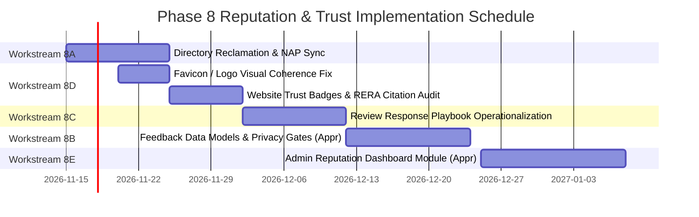

# Ratiwal Dream Estates — Phase 8 Implementation Roadmap

**Website:** https://www.ratiwaldreamestates.com/  
**Framework:** Next.js 16 App Router  
**Scope:** Phased Rollout of Reputation, Feedback & Trust Management  
**Date:** November 2026

---

## 1. Ten-Week Phased Execution Plan

The implementation of Phase 8 is structured across five sequential workstreams to avoid operational disruption:

---

## 2. Workstream Breakdown & Approval Gates

### Workstream 8A: Platform Reclamation & Citation Alignment (Weeks 1–2)
- Reclaim unmanaged directory listings on real estate portals.
- Update profile descriptions with official website URL (`https://www.ratiwaldreamestates.com`).
- **Effort:** 6 Hours | **Approval:** Marketing Lead | **Risk:** Zero Code Risk.

### Workstream 8D: Website Trust Architecture & Logo Alignment (Weeks 2–3)
- **Immediate Task:** Regenerate favicon files (`favicon.ico`, `favicon.png`, `src/app/icon.png`) from `favicon.svg` using `sharp` so the Google search snippet icon matches the website header logo perfectly.
- Ensure all RERA citations cite `RAJ/A/2019/983` consistently.
- **Effort:** 3 Hours | **Approval:** Owner Review | **Risk:** Low.

### Workstream 8C: Review Response Workflow (Weeks 4–5)
- Distribute `SEO_PHASE_8_REVIEW_RESPONSE_GUIDELINES.md` to customer support and advisory personnel.
- Establish the 2-step response approval process with the Principal Advisor.
- **Effort:** 4 Hours | **Approval:** Principal Advisor | **Risk:** Operational Only.

### Workstream 8B: Staged Feedback System (Weeks 6–7 — Subject to Approval)
- Create `CustomerFeedback` Mongoose schema with strict privacy gates and non-publishing defaults.
- Deploy automated WhatsApp feedback triggers for post-site-visit consultations.
- **Effort:** 12 Hours | **Approval:** Explicit Owner Approval Required | **Risk:** Low.

### Workstream 8E: Admin Dashboard Integration (Weeks 8–10 — Subject to Approval)
- Build `/dashboard/reputation` command center for review oversight, feedback triage, and response staging.
- **Effort:** 16 Hours | **Approval:** Explicit Owner Approval Required | **Risk:** Admin Only.
