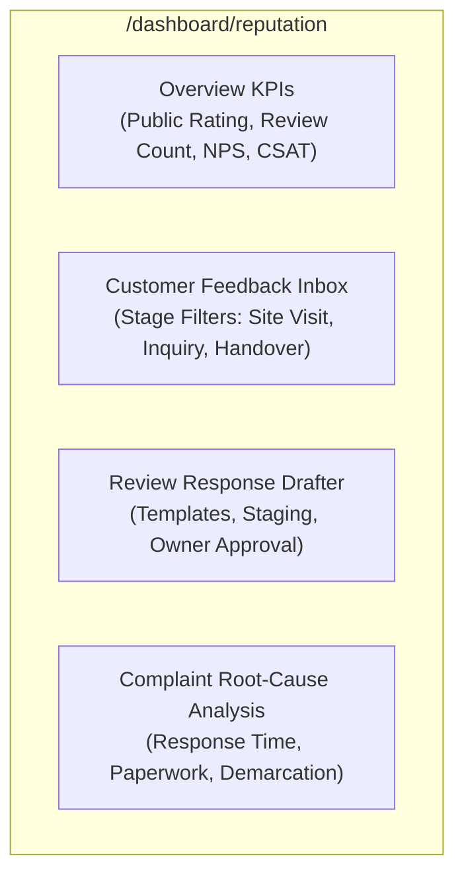

# Ratiwal Dream Estates — Phase 8 Reputation Dashboard PRD

**Website:** https://www.ratiwaldreamestates.com/  
**Framework:** Next.js 16 App Router  
**Module:** Reputation, Customer Trust & Feedback Management  
**Route Allocation:** `/dashboard/reputation` (Awaiting Owner Approval)  
**Date:** November 2026

---

## 1. Product Vision & Value Proposition

The Reputation Management Module equips the Ratiwal Dream Estates leadership team with a unified command center to:
1. Track public customer ratings across Google Business Profile.
2. Monitor multi-stage internal customer feedback across site visits and advisory consultations.
3. Manage, investigate, and resolve customer grievances before they escalate into negative public reviews.
4. Draft, approve, and track professional responses to customer reviews.

---

## 2. Key Functional Requirements

### Feature 1: Executive Reputation KPI Cards
- **Public Google Rating:** Current verified average rating (e.g., 4.9 ★) with date of last verification.
- **Total Public Reviews:** Aggregate count of verified third-party reviews.
- **Internal CSAT Score:** Calculated customer satisfaction percentage from on-ground site visit feedback.
- **Grievance Resolution Rate:** Percentage of complaints resolved within 48 hours.

### Feature 2: Staged Feedback Inbox
- Filter by Lifecycle Stage (`INITIAL_INQUIRY`, `DOCS_REVIEW`, `SITE_VISIT`, `BOOKING`, `POST_REGISTRY`).
- Quick Sentiment Indicators: Green (Positive, 4–5 Stars), Yellow (Neutral, 3 Stars), Red (Critical Issue, 1–2 Stars).
- Deep linking to the associated `Lead`, `Property`, and `SiteVisit` records.

### Feature 3: Review Response Drafter & Approval Queue
- A dedicated staging interface to compose public review responses using pre-approved Phase 8 playbooks.
- **Two-Step Approval Gate:**
  1. Operations/Support drafts the response.
  2. Principal Advisor (`suresh-kumawat`) clicks "Approve Response".
  3. One-click copy with direct link to Google Business Profile manager.

### Feature 4: Grievance & Complaint Tracker
- Categorization tags:
  - `DOCUMENTATION_AMBIGUITY`
  - `ADVISOR_DELAY`
  - `SITE_COORDINATION`
  - `PRICING_CLARIFICATION`
- Escalation status: `OPEN` -> `UNDER_INVESTIGATION` -> `RESOLVED_WITH_CLIENT` -> `CLOSED`.

---

## 3. Technical Architecture & Next.js 16 Alignment

- **UI Standards:** Built using existing dashboard styling (`src/components/dashboard/`, Tailwind CSS, Lucide Icons, unified dashboard shell).
- **Backend Services:** `ReputationService` located at `src/lib/services/reputation.service.ts`.
- **Database Model:** `CustomerFeedback.ts` and `PublicReview.ts` registered in Mongoose.
- **Security:** Protected by existing RBAC middleware (`ADMIN_SESSION_SECRET`); only users with `REPUTATION_MANAGE` permissions can approve public response drafts.

---

## 4. Implementation Effort & Governance Gate

| Sub-Component | Development Effort | Security Scope | Explicit Approval Required? |
|:---|:---:|:---:|:---:|
| Schema Definition (`CustomerFeedback.ts`) | 3 Hours | Internal DB Model | **Yes** |
| Reputation Service & API Handlers | 5 Hours | Server-Side Only | **Yes** |
| Dashboard UI Pages (`/dashboard/reputation`) | 8 Hours | Admin Portal Only | **Yes** |
| Public Feedback Form Component | 4 Hours | Public Client Component | **Yes** |
| Total Module Implementation | **20 Hours** | Full System | **Owner Approval Required** |
