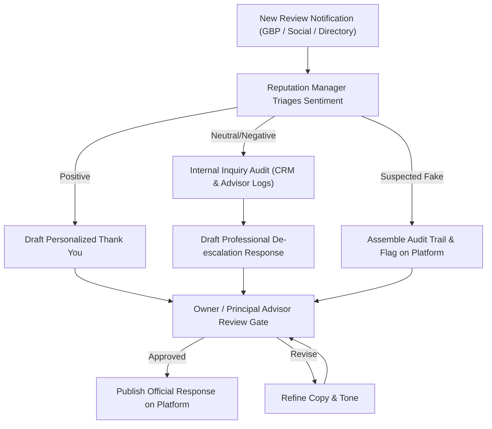

# Ratiwal Dream Estates — Phase 8 Review Response Guidelines & Playbook

**Website:** https://www.ratiwaldreamestates.com/  
**Framework:** Next.js 16 App Router  
**Scope:** Workstream 8C — Public Review Response Protocols, Tone of Voice & Templates  
**Date:** November 2026

---

## 1. Principles of Public Review Management

Every public response published by Ratiwal Dream Estates reflects the character, dignity, and integrity of the firm. Public responses are read not only by the reviewer, but by hundreds of prospective land buyers evaluating the business's temperament and accountability.

### Non-Negotiable Core Principles:
1. **Calm & Dignified Tone:** Never engage in defensive arguments, sarcasm, or aggressive rebuttals—even when faced with unfair criticism.
2. **Strict Privacy Protection:** Never disclose private transaction sums, plot numbers, client personal names, or confidential dispute details in public responses.
3. **Accountability & Direct Access:** For critical concerns, immediately offer direct access to leadership (`advisory@ratiwaldreamestates.com` or `+91-9929533436`).
4. **Mandatory Human Approval:** Automated auto-responders are strictly prohibited. Every response must be approved by the Principal Advisor before posting.

---

## 2. Response Protocols & Template Playbook

### Scenario A: Positive Reviews (5-Star / Satisfied Buyer)
* **Objective:** Express sincere appreciation, reinforce core brand values (transparency, legal due diligence), and maintain professionalism without repetitive corporate clichés.

> **Template A1 (General Due Diligence & Paperwork):**
> *"Dear [Client Name / Sir/Ma'am], thank you for taking the time to share your feedback. Ensuring complete transparency around land documentation, Section 90-A sanctions, and JDA demarcations before any financial commitment is the foundational principle of our advisory. We are truly delighted that your experience was reassuring and clear. Wishing you the very best with your land investment, and we remain at your service for any future requirements. Warm regards, Suresh Kumawat & The Ratiwal Dream Estates Team."*

> **Template A2 (Out-of-Town / NRI Buyer):**
> *"Dear [Client Name], thank you for your kind words. Coordinating property acquisitions from a distance requires absolute trust and meticulous documentation. We are glad our digital surveys, certified revenue records, and remote liaison met your expectations. Thank you for placing your trust in Ratiwal Dream Estates. Best regards, Advisory Desk."*

---

### Scenario B: Neutral or Mixed Reviews (3 to 4 Stars)
* **Objective:** Acknowledge constructive criticism with humility, clarify operational facts respectfully, and provide an escalation channel to resolve any lingering concerns.

> **Template B1 (Minor Communication or Scheduling Delays):**
> *"Hello [Reviewer Name], thank you for your balanced feedback. While we are glad you found our legal and property shortlisting helpful, we sincerely regret that our follow-up communication took longer than our standard benchmark. During high-inquiry periods, our advisors strive to maintain thoroughness, but we acknowledge that prompt updates are equally important. We have addressed this internally to streamline our scheduling. If there are any pending details you require regarding your site visit or documentation, please connect with us directly at +91-9929533436. Sincerely, Ratiwal Dream Estates Support Desk."*

---

### Scenario C: Negative Reviews (1 to 2 Stars / Critical Grievances)
* **Objective:** De-escalate public tension, demonstrate empathy, take ownership of the experience, and move the conversation immediately to a private, high-level resolution channel.

> **Template C1 (Dissatisfaction with Information or Availability):**
> *"Dear [Reviewer Name], we take all feedback with utmost seriousness and are genuinely concerned to learn that your experience did not reflect the high standard of clarity and professionalism we hold ourselves to. We would welcome the opportunity to investigate your specific concern and make things right. Because we maintain strict privacy around all client interactions, could you please connect with our leadership team directly at advisory@ratiwaldreamestates.com or call +91-9929533436 with your inquiry reference? We are committed to addressing this promptly and thoroughly. Sincerely, Suresh Kumawat, Principal Advisor."*

---

### Scenario D: Suspected Fake, Defamatory, or Competitor Attack Reviews
* **Objective:** Provide a measured public clarification stating that no record exists, while simultaneously initiating the platform's official reporting procedure.

> **Strict Rules for Fake Reviews:**
> - Never accuse the reviewer of being a competitor or fraud publicly.
> - Never threaten legal action in the public comment (handle legal notices privately).
> - File an official "Flag Review / Policy Violation" report on Google Business Profile with supporting documentation.

> **Template D1 (No Matching Customer Record):**
> *"Hello [Reviewer Name], we have conducted an exhaustive search of our advisory logs, site visit registers, and client records, but cannot locate any interaction or mandate under this name. As a RERA-registered consultancy (RAJ/A/2019/983), we maintain transparent documentation for every client we serve. If you have genuinely interacted with our team or visited one of our partner townships, please reach out directly to advisory@ratiwaldreamestates.com or +91-9929533436 so we can verify your visit and resolve your concern immediately. If this was posted in error or for an unrelated entity, we kindly request you to re-check the business listing. Thank you."*

---

## 3. Review Response Approval Workflow

